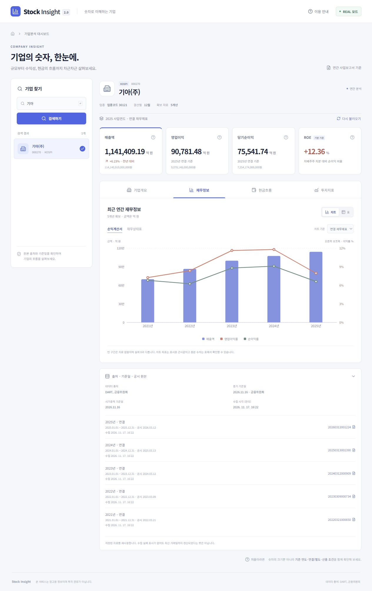

# Stock Insight 2.0

기업명·종목코드로 국내 상장사의 연간 재무와 투자지표를 읽는 로컬 풀스택 웹 앱입니다. 검색→기업 선택→요약 카드→기업개요·재무정보·현금흐름·투자지표4탭으로 이어집니다. 현재 앱 버전은 **0.6.0**, 문서는 Phase7에서 정리했습니다.

구현·자동 테스트·실제 API 연동·브라우저 검증을 수행했습니다. **사용자의3종목 DART 공시 화면 직접 대조는 미확인**입니다. 전체 사용자 검증까지 완료했다고 표시하지 않습니다.

## 평소 실제 기업을 볼 때

현재 PC에는 필요한 실행 파일·라이브러리와 키 설정이 준비돼 있습니다. PowerShell 창 **하나**에서 실행합니다.

```powershell
powershell.exe -NoProfile -ExecutionPolicy Bypass -File "C:\Users\rhfov\Documents\Codex\2026-11-17\phase-0-phase-1\outputs\stock-insight-frontend\scripts\start-phase5-local.ps1" -Mode Real
```

READY 후 [실제 기업 화면](http://127.0.0.1:5195/)에서 기아 또는000270을 검색하고 선택합니다. 사용하는 동안 창을 열어 두고, 종료할 때는 그 창에서 **Enter**를 누릅니다. 다음 날에는 같은 명령을 다시 실행합니다. DB와 키 설정 파일은 보존됩니다.

파일 이름은 phase5지만 현재 백엔드0.6.0을 실행합니다. 각 명령이 DB→백엔드→화면을 자동으로 시작하므로 셋을 따로 켤 필요가 없습니다.

| 사용할 기능 | 실행 방법·창 수 | 브라우저 |
|---|---|---|
| 실제 기업 |위 Real 명령·1개 창 |[5195](http://127.0.0.1:5195/) |
| 가상 사례 |같은 명령의 `-Mode Mock`·1개 창 |[5194](http://127.0.0.1:5194/) |
| 실제+가상 |각각 실행·2개 창 |위 두 주소 |
| 품질·오류 검증 |`start-quality-check.ps1`·별도1개 창, 단독 실행 가능 |[5206 제어](http://127.0.0.1:5206/__quality) |
| 모두 사용 |세 명령·3개 창 |위 세 주소 |

**명령 전체·시작/종료·재부팅 후 실행·오류 점검은 [PowerShell 실행 안내](stock-insight-frontend/docs/local-run-guide.md)에 있습니다.**

**백엔드는 IntelliJ, 프론트는 VS Code에서 개발하려면 [IDE 실행 안내](docs/ide-development-guide.md)를 따릅니다.** MySQL만 켜는 전용 명령과 IDE 환경변수·포트·실행 순서를 정리했습니다.

**Swagger UI도 제공합니다.** IntelliJ 백엔드는 [8080 Swagger](http://127.0.0.1:8080/swagger-ui.html), Real 일괄 실행은 [18095 Swagger](http://127.0.0.1:18095/swagger-ui.html)에서 API를 확인·실행합니다. [사용 안내](stock-insight-backend/docs/swagger-guide.md)에 모드별 경로·Try it out·OpenAPI 저장 방법을 정리했습니다.

## 처음 준비하거나 빌드 파일이 없을 때

현재 PC가 아닌 곳에서는 프로젝트 경로와 설치된 Java 경로를 바꿔 사용합니다. native 실행 스크립트는 Windows의 MySQL Server8.0 설치 경로, Node, Java21이 필요합니다. Docker 경로는 백엔드 README에 별도로 제공합니다.

| 항목 | 구현·검증 환경 |
|---|---|
| Java |21, Amazon Corretto21.0.12 |
| Spring Boot·Gradle |3.5.16·Wrapper8.10.2 |
| MySQL |native8.0.46 검증, Compose 설정8.4.13 |
| Node·npm |24.19.0·12.0.2 |
| React·React DOM·react-is |19.3.1 |
| TypeScript·Vite |7.0.2·8.3.8 |
| Tailwind·Recharts·Lucide |4.3.5·3.10.1·1.73.0 |
| 테스트 |JUnit5·Mockito·Spring Boot Test, Node 내장 테스트 |

첫 빌드에는 Gradle·npm 의존성을 내려받을 네트워크가 필요할 수 있습니다. 실제 설치 조합은 build.gradle·Gradle Wrapper·package-lock.json을 기준으로 재현합니다.

```powershell
$env:JAVA_HOME = 'C:\Program Files\Amazon Corretto\jdk21.0.12_8'
Set-Location 'C:\Users\rhfov\Documents\Codex\2026-11-17\phase-0-phase-1\outputs\stock-insight-backend'
.\gradlew.bat bootJar
Set-Location 'C:\Users\rhfov\Documents\Codex\2026-11-17\phase-0-phase-1\outputs\stock-insight-frontend'
npm.cmd ci
npm.cmd run build
```

Mock은 외부 키가 필요하지 않습니다. Real은 백엔드 `.env.real`을 사용합니다. 파일이 없을 때만 예시를 복사하고 DART·FSC 키를 로컬 파일에 넣습니다. 기존 키 파일을 덮어쓰지 않습니다.

```powershell
Set-Location 'C:\Users\rhfov\Documents\Codex\2026-11-17\phase-0-phase-1\outputs\stock-insight-backend'
if (-not (Test-Path -LiteralPath '.env.real')) {
    Copy-Item -LiteralPath '.env.real.example' -Destination '.env.real'
}
notepad .env.real
```

DART 키는 기업·재무 조회, FSC 키는 금융위원회 주식시세 서비스의 승인된 Decoding 키입니다. FSC가 없으면 시세 관련 지표가 N/A이며 재무 기반 지표는 계속 확인할 수 있습니다. 키·환경변수의 적용 방식은 [키 설정 안내](stock-insight-backend/docs/api-keys-and-real-run.md)에 있습니다. 실제 키는 Git·문서·채팅에 넣지 않습니다.

## 화면과 데이터 기준

기업개요에는 업종·결산월·우선주·종가·시가총액과 기준일을 표시합니다. 재무정보에는 최대5개년 매출 막대·이익률 선·오른쪽% 보조축, 손익/재무상태표 전환이 있습니다. 현금흐름은3종 활동의 추이와 의미를, 투자지표는7개 카드·표와 설명을 제공합니다.

공식·사용 계정·N/A 조건은 **[금융지표 기준5.3](stock-insight-backend/docs/financial-policy.md#53-지표-기준표)**이 기준입니다. 다른 문서에서 별도 기준을 정의하지 않습니다. ROE는 지배주주 기준·기말, ROA는 기말, EPS는 공시된 보통주 기본주당이익, BPS는 확인된 보통주 기준입니다.

원본 계정·금액·기간·접수번호·출처·수집 시각을 보존합니다. REAL 실패를 가상 자료로 대체하지 않습니다. 금융 계산은 백엔드 BigDecimal로 처리하고 프론트엔드는 표시만 변환합니다.0과 음수는 결측과 구분하며 N/A에는 사유를 표시합니다.

### 알려진 금융·구현 제한

- 금융업 미지원, 연간 사업보고서만 지원. 분기·반기·TTM 없음.
- ROE·ROA는 기말 기준이며 평균 기준 지표가 아님.
- 우선주 발행 기업 BPS·PBR N/A, 보통주 범위를 확인할 수 없는 공시 EPS의 EPS·PER N/A.
- 주식 분할·무상증자 등으로 과거 EPS가 단절될 수 있으며 자동 보정하지 않음.
- 재작성 전기 수치를 과거 보고서 값에 자동 반영하지 않음.
- 저장 공시·시세 재사용. 실시간 주가·최신 정정 공시·최신 거래일을 자동 보장하지 않음.
- 금융위원회 시세를 사용하며 별도 KRX Client는 구현하지 않음. 시가총액은 조회한 보통주 종목 범위.
- 실제 휴대전화 전체·다수 브라우저·장시간 부하는 미검증. 인증·공개 배포·Actuator·Testcontainers는 범위 밖.

상세 조건은 [정책5.6](stock-insight-backend/docs/financial-policy.md#56-알려진-제한)과 [검증·남은 확인](docs/verification.md)에 있습니다. 참고 정보 제공 앱이며 투자 권유나 수익성 검증을 구현한 것은 아닙니다.

## 구조·설계 문서

**전체 설계는 [소프트웨어 설계 명세서(SDD)](docs/SDD.md)**에서 확인합니다. 현행0.6.0 기준 요구사항·아키텍처·모듈·DB·API·화면 상태·운영·검증 추적을 정리했습니다.

```text
outputs/
  README.md                       이 프로젝트의 시작 문서
  docs/
    SDD.md                        소프트웨어 설계 명세·요구사항 추적
    design-decisions.md           설계 결정·대안·제약
    portfolio.md                  기술 설명·시연·면접 준비
    verification.md               테스트 재현·증거·미확인 항목
    phase-7-documentation.md      문서화 완료·정합성 검사
  stock-insight-backend/
    src/main/java/                API·수집·정규화·저장·계산
    src/main/resources/           설정·Flyway V1/V2
    src/test/                     단위·DB·실응답 테스트
    docs/                         API·DB·아키텍처·금융 정책·증거
    scripts/                      일반 실행·격리 MySQL 테스트
  stock-insight-frontend/
    src/                          React·타입·표시·차트
    scripts/                      Mock·Real·QA 실행
    docs/                         실행 안내·검증·화면 캡처
```

| 알고 싶은 내용 | 문서 |
|---|---|
| 전체 소프트웨어 설계·요구사항 추적 |[SDD](docs/SDD.md) |
| 서버 켜기·끄기·재시작 |[PowerShell 안내](stock-insight-frontend/docs/local-run-guide.md) |
| IntelliJ·VS Code에서 실행 |[IDE 개발 안내](docs/ide-development-guide.md) |
| GitHub 저장소·다시 받기 |[저장소 안내](docs/github-repository-guide.md) |
| 프론트 개발 |[프론트엔드 README](stock-insight-frontend/README.md) |
| 백엔드 개발·환경변수 |[백엔드 README](stock-insight-backend/README.md) |
| HTTP API·응답·오류 |[API 명세](stock-insight-backend/docs/api.md) |
| Swagger UI·OpenAPI |[사용 안내](stock-insight-backend/docs/swagger-guide.md) |
| 데이터 흐름·트랜잭션·캐시 |[아키텍처](stock-insight-backend/docs/architecture.md) |
| 테이블·키·인덱스·관계·갱신 |[DB 명세·ERD](stock-insight-backend/docs/database.md) |
| 금융 공식·정밀도·한계 |[금융 정책5.3·5.6](stock-insight-backend/docs/financial-policy.md) |
| 선택 이유·대안 |[설계 결정 기록](docs/design-decisions.md) |
| 포트폴리오·면접 설명 |[기술 설명](docs/portfolio.md) |
| 테스트·검증 상태 |[검증 안내](docs/verification.md) |

## 테스트 실행과 확인 상태

프론트엔드는 해당 폴더에서 `npm.cmd test`, `npm.cmd run build`로 검사합니다. 백엔드의 MySQL 포함 전체 테스트는 별도 PowerShell에서 다음을 실행합니다. 테스트가 끝나면 전용 DB도 자동 종료합니다.

```powershell
powershell.exe -NoProfile -ExecutionPolicy Bypass -File "C:\Users\rhfov\Documents\Codex\2026-11-17\phase-0-phase-1\outputs\stock-insight-backend\scripts\verify-mysql.ps1"
```

| 구분 | 직접 확인한 결과 |
|---|---|
| 자동 테스트 |백엔드222개 통과(Swagger 추가 후), 프론트엔드21개 통과(기존 화면 검증) |
| DB 통합 |실제 MySQL·Flyway V1→V2 보존·재조회·갱신 실패 보존 통과 |
| 패키지 HTTP |17개 보안·정적 자산·오류 주입 검사 통과 |
| 브라우저 |15개 정상·오류·복구·지연·390px 시나리오 통과 |
| 실데이터 |DART·금융위원회 인증·수집,0.6.0에서4기업5개년 HTTP 회귀 통과 |
| 사용자 수동 검증 |**기아·롯데케미칼·삼성전자 공시 화면 직접 대조 미확인** |

증거 파일·실행 범위·미검증 항목은 [검증 안내](docs/verification.md)에 있습니다. 백엔드의 일반 `gradlew test`는 DB 환경변수가 없으면 통합 테스트를 건너뛰므로 전체 검증과 구분합니다. npm audit의 당시 취약점0 결과를 Java 전체 의존성 검사 결과로 확대하지 않습니다.

## 화면

아래는 저장한 실제 브라우저 검증 화면입니다. 캡처 당시의 공시·시세 기준이며 현재 시세를 의미하지 않습니다.



추가 화면: [모바일](stock-insight-frontend/docs/screenshots/phase6-production-mobile.jpg), [적자 기업](stock-insight-frontend/docs/screenshots/phase5-real-loss.jpg), [우선주 N/A](stock-insight-frontend/docs/screenshots/phase5-real-preferred.jpg), [오류 처리](stock-insight-frontend/docs/screenshots/phase6-partial-error.jpg).

문서화의 완료 범위와 학습 과제·커밋 제안은 [Phase7 보고](docs/phase-7-documentation.md)에 정리했습니다. 다음 확인은 [사용자 공시 대조표](stock-insight-backend/docs/live-verification-table.md)입니다.
