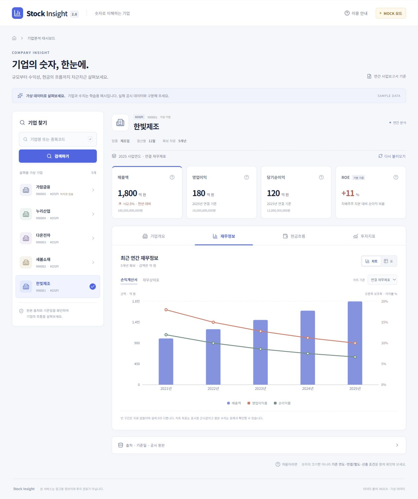
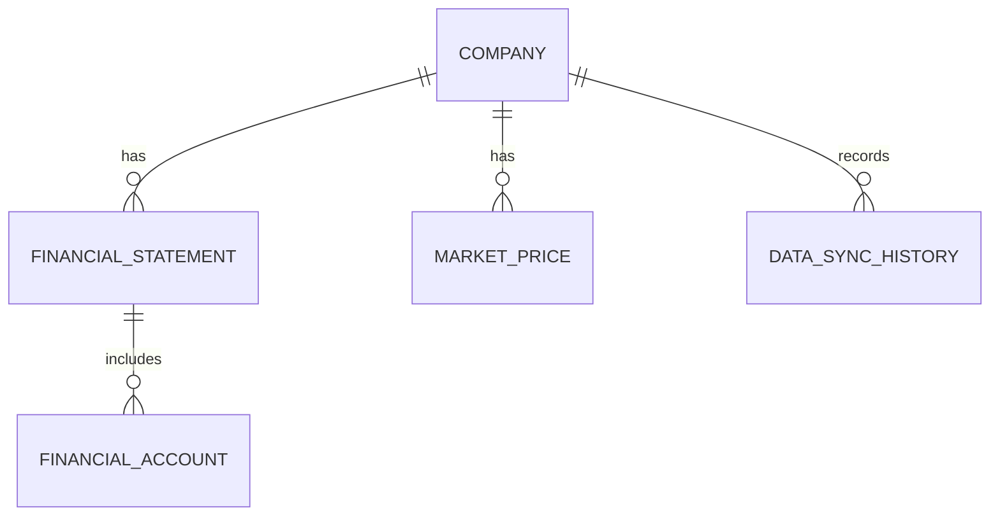

# Stock Insight 2.0

> 국내 상장사 연간 재무·투자지표 대시보드 — Java 21 · Spring Boot · React · TypeScript · MySQL

기업명·종목코드로 회사를 검색하고 **기업개요·재무정보·현금흐름·투자지표**를 확인하는 로컬 풀스택 프로젝트입니다. 현재 백엔드·프론트 버전은 **0.6.0**입니다.

DART·금융위원회 주식시세정보 V2를 사용하며, 외부 키 없이 체험하는 **MOCK 모드**와 실제 기업을 조회하는 **REAL 모드**를 분리했습니다. 현재 제공 범위는 로컬 실행입니다.

[SDD](docs/SDD.md) · [Swagger 안내](stock-insight-backend/docs/swagger-guide.md) · [IntelliJ·VS Code 안내](docs/ide-development-guide.md) · [PowerShell 시작·종료](stock-insight-frontend/docs/local-run-guide.md)



## 핵심 기능

- 기업명·6자리 종목코드 검색과 기업 기본정보 조회.
- 최대5개년 연간 재무, 연결(CFS) 우선·자료 없음 시 별도(OFS) 사용.
- 매출·이익·재무상태·3개 활동 현금흐름의 차트·표 제공.
- 최신 연간10개 지표와 연도별 영업·순이익률 제공.
- 공식·사용 계정·설명·N/A 사유·기준일 표시.
- 원본 계정·접수번호·기간·출처·수집 시각 보존.
- REAL 재수집 API와 실패 시 기존 정상 스냅샷 보존.
- Swagger UI·OpenAPI JSON/YAML, 가상 사례·오류 주입 QA.

금융 계산은 백엔드 BigDecimal로 처리합니다. 프론트는 표시 단위를 변환하며 확인된0·음수와 결측을 구분합니다.

## 기술 스택

| 구성 | 기술·버전 | 용도 |
|---|---|---|
| Backend |Java21 · Spring Boot3.5.16 |REST API·수집·정규화·계산 |
| Persistence |Spring Data JPA · Flyway |저장·조회·마이그레이션 |
| DB |native MySQL8.0.46 검증 / Compose 정의8.4.13 |기업·재무·시세·이력 |
| Build |Gradle Wrapper8.10.2 |백엔드 빌드·테스트 |
| API Docs |springdoc2.10.0 · OpenAPI3.0 |Swagger UI·명세 |
| Frontend |React19.3.1 · TypeScript7.0.2 |대시보드·상태·계약 |
| UI |Tailwind CSS4.3.5 · Recharts3.10.1 · Lucide |스타일·차트·아이콘 |
| Frontend Build |Vite8.3.8 · Node24 이상 |개발 서버·프록시·빌드 |
| Test |JUnit5 · Mockito · MySQL 통합 · Node 내장 테스트 |계산·API·DB·응답 검사 |

정확한 의존성은 [build.gradle](stock-insight-backend/build.gradle)과 [package.json](stock-insight-frontend/package.json)·[package-lock.json](stock-insight-frontend/package-lock.json)을 기준으로 합니다.

## 프로젝트 구조

```text
finance/                                # Git 저장소 루트
├── README.md                           # GitHub 시작 문서
├── .gitignore                          # 실제 키·DB·캐시·빌드 제외
├── .gitattributes                      # 줄바꿈 관리
├── outputs/
│   ├── README.md                       # 프로젝트 안내
│   ├── docs/                           # SDD·설계 결정·검증·IDE 안내
│   ├── stock-insight-backend/
│   │   ├── src/main/java/com/stockinsight/
│   │   │   ├── api/                    # Controller·DTO·Swagger·오류·로컬 정책
│   │   │   ├── service/                # 조회·수집·저장·계산
│   │   │   ├── provider/               # DART·FSC·정규화·Mock
│   │   │   ├── domain/                 # JPA Entity·enum
│   │   │   ├── repository/             # JPA Repository
│   │   │   └── StockInsightApplication.java
│   │   ├── src/main/resources/
│   │   │   ├── application.yml         # 공통·Mock 기본 설정
│   │   │   ├── application-real.yml    # Real 설정
│   │   │   └── db/migration/           # Flyway V1·V2
│   │   ├── src/test/                   # 계산·공급원·HTTP·MySQL 검사
│   │   ├── scripts/                    # DB 전용 실행·전체 테스트
│   │   ├── docs/                       # API·DB·금융 정책·OpenAPI
│   │   ├── .env.example                # Mock 단독 실행 예시
│   │   ├── .env.real.example           # Real 예시
│   │   ├── .env.real                   # 로컬 키 파일, Git 제외
│   │   └── build.gradle
│   └── stock-insight-frontend/
│       ├── src/
│       │   ├── components/             # 대시보드·차트·도움말
│       │   ├── lib/                    # fetch·타입·계약·표시·테스트
│       │   ├── DashboardApp.tsx        # 검색·선택·요청·상태
│       │   ├── App.tsx
│       │   └── main.tsx
│       ├── scripts/                    # Mock·Real·QA 실행
│       ├── docs/                       # 사용 안내·검증·화면
│       ├── .env.example                # 프록시 예시
│       ├── .env.local                  # 로컬 프록시 설정, Git 제외
│       ├── vite.config.ts
│       └── package.json
└── work/                               # 로컬 DB·캐시·로그, Git 제외
```

`.env.real`·`.env.local`·`work`는 로컬에서 준비·생성합니다. GitHub 소스에는 실제 키·저장 DB가 포함되지 않습니다.

## 로컬 실행 준비

### 필요한 프로그램

Java21·MySQL Server·Node24 이상·Git을 준비합니다. 백엔드는 IntelliJ, 프론트는 VS Code에서 엽니다. **MySQL은 MOCK에서도 필요**하며 Workbench는 선택 도구입니다.

Windows 실행 스크립트는 `C:\Program Files\MySQL\MySQL Server 8.0`의 native MySQL을 사용합니다. Java는 현재 PC의 Corretto21 경로 또는 JAVA_HOME을 사용합니다. 다른 PC에서는 설치 경로를 확인합니다. Docker 방식은 [백엔드 README](stock-insight-backend/README.md)에 별도로 있으며 현재 PC에서는 native 경로를 검증했습니다.

### 프로젝트 받기·첫 빌드

```powershell
git clone https://github.com/wjdgns5/finance.git
Set-Location '.\finance'
```

**저장소 루트는 `.git`·`outputs`가 있는 finance 폴더입니다.** 기존 PC에서는 `C:\Users\rhfov\Documents\Codex\2026-11-17\phase-0-phase-1`이 루트입니다. 아래 명령은 별도 표시가 없으면 저장소 루트에서 실행합니다.

JAVA_HOME이 Java21을 가리키도록 설정한 뒤 최초 빌드합니다.

```powershell
Set-Location '.\outputs\stock-insight-backend'
.\gradlew.bat bootJar
Set-Location '..\stock-insight-frontend'
npm.cmd ci
Set-Location '..\..'
```

첫 의존성 다운로드에는 인터넷 연결이 필요할 수 있습니다. 코드·잠금 파일 변경 없이 다음 날 다시 켤 때마다 설치·빌드할 필요는 없습니다.

## 백엔드 환경변수 설정 (.env)

환경파일은 `build.gradle`과 같은 백엔드 폴더에 둡니다. **현재 실제 모드는 `.env.real`을 사용**하고 `.env`는 Mock 단독 실행용입니다.

| 파일 | 용도 |
|---|---|
| outputs/stock-insight-backend/.env |run-local.ps1·Compose의 Mock 단독 실행 |
| outputs/stock-insight-backend/.env.real |Real 일괄 실행·IDE의 실제 키 설정 |
| .env.example·.env.real.example |Git에 포함되는 빈 키 예시 |

Real 파일이 없다면 루트에서 복사합니다. 기존 파일은 보존합니다.

```powershell
if (-not (Test-Path -LiteralPath '.\outputs\stock-insight-backend\.env.real')) {
    Copy-Item -LiteralPath '.\outputs\stock-insight-backend\.env.real.example' -Destination '.\outputs\stock-insight-backend\.env.real'
}
```

### .env 내용

다음은 **`.env.real` 예시**입니다. 키는 로컬 파일에서 입력합니다. 아래 비밀번호는 예시 환경의 로컬 DB 값입니다.

```dotenv
SPRING_PROFILES_ACTIVE=real
APP_DATA_MODE=REAL

MYSQL_DATABASE=stock_insight_real
MYSQL_USER=stock_insight
MYSQL_PASSWORD=local_real_password
MYSQL_ROOT_PASSWORD=local_real_root_password
MYSQL_PORT=13307
SERVER_PORT=8081

# 실제 키는 로컬 파일에서만 입력
DART_API_KEY=
FSC_API_KEY=
```

| 변수 | 설명 |
|---|---|
| SPRING_PROFILES_ACTIVE |mock 또는 real 프로필 |
| APP_DATA_MODE |MOCK 또는 REAL. 프로필과 함께 맞춤 |
| MYSQL_DATABASE·MYSQL_USER·MYSQL_PASSWORD |DB 스크립트의 DB·사용자·비밀번호 |
| MYSQL_ROOT_PASSWORD |로컬 전용 MySQL 초기 설정 |
| MYSQL_PORT·SERVER_PORT |단독 실행 기본 포트. IDE·일괄 실행은 별도 포트 명시 |
| DB_URL·DB_USERNAME·DB_PASSWORD |직접 datasource를 지정하는 Spring 설정 |
| DART_API_KEY |DART 기업·재무 인증키 |
| FSC_API_KEY |금융위원회 서비스의 승인된 Decoding 키 |

Mock 단독 실행은 [`.env.example`](stock-insight-backend/.env.example)을 사용합니다. 화면까지 켜는 Mock 일괄 실행은 외부 키 없이 DB를 준비합니다. REAL 키 값은 제공 스크립트 형식에 맞춰 따옴표 없이 입력합니다.

### application.yml

아래는 [현재 application.yml](stock-insight-backend/src/main/resources/application.yml)의 **핵심 발췌**입니다.

```yaml
spring:
  profiles:
    default: mock
  datasource:
    url: ${DB_URL:jdbc:mysql://127.0.0.1:13306/stock_insight_mock?useSSL=false&allowPublicKeyRetrieval=true&connectionTimeZone=UTC}
    username: ${DB_USERNAME:stock_insight}
    password: ${DB_PASSWORD:local_mock_password}
  jpa:
    open-in-view: false
    hibernate:
      ddl-auto: validate
  flyway:
    enabled: true
    clean-disabled: true

server:
  address: 127.0.0.1
  port: ${SERVER_PORT:8080}

app:
  data-mode: ${APP_DATA_MODE:MOCK}
  dart:
    base-url: https://opendart.fss.or.kr/api
    api-key: ${DART_API_KEY:}
  fsc:
    base-url: https://apis.data.go.kr/1160100/GetStockSecuritiesInfoService_V2
    price-path: /getStockPriceInfo_V2
    api-key: ${FSC_API_KEY:}
```

real 프로필에서는 [application-real.yml](stock-insight-backend/src/main/resources/application-real.yml)도 적용합니다.

```yaml
app:
  data-mode: REAL

spring:
  datasource:
    url: ${DB_URL:jdbc:mysql://127.0.0.1:13306/stock_insight_real?useSSL=false&allowPublicKeyRetrieval=true&connectionTimeZone=UTC}
```

**Spring Boot는 `.env`·`.env.real`을 자동으로 읽지 않습니다.** 스크립트 또는 IntelliJ가 환경변수로 로드해야 합니다. `MYSQL_*`는 DB 스크립트용이고, 제공 스크립트가 `DB_*`를 구성하거나 IDE 인자로 datasource를 지정합니다. `MYSQL_PORT`만 설정해도 Spring datasource 포트가 자동으로 바뀌지는 않습니다.

### IntelliJ에서 .env 읽는 법

1. `outputs/stock-insight-backend`를 Gradle 프로젝트로 엽니다.
2. Project SDK·Gradle JVM을 **Java21**, Gradle 배포판을 **Wrapper**로 설정합니다.
3. **Run → Edit Configurations → + → Application**에서 실행 구성을 만듭니다. 사용 가능한 경우 Spring Boot 유형도 가능합니다.

| 항목 | 값 |
|---|---|
| Name |Stock Insight Real IDE |
| Main class |com.stockinsight.StockInsightApplication |
| Classpath module |백엔드 main 소스가 포함된 모듈 |
| Working directory |클론한 저장소의 outputs/stock-insight-backend |
| Environment variables 파일 |같은 백엔드 폴더의 .env.real |

**Environment variables** 옆의 파일 선택 기능으로 `.env.real`을 지정합니다. 항목이 숨겨져 있으면 Modify options에서 표시합니다. 버전에 파일 선택 기능이 없다면 환경변수 표에 `SPRING_PROFILES_ACTIVE`, `APP_DATA_MODE`, `MYSQL_USER`, `MYSQL_PASSWORD`, `DART_API_KEY`, `FSC_API_KEY`를 파일과 같은 값으로 등록합니다. [IntelliJ 공식 안내](https://www.jetbrains.com/help/idea/program-arguments-and-environment-variables.html)

**Program arguments**에는 아래4줄을 그대로 넣습니다. 한 줄 입력칸이면 공백으로 이어 붙입니다. `${MYSQL_USER}`, `${MYSQL_PASSWORD}`는 그대로 두면 Spring이 로드된 값을 읽습니다.

```text
--server.port=8080
--spring.datasource.url=jdbc:mysql://127.0.0.1:13397/stock_insight_real?useSSL=false&allowPublicKeyRetrieval=true&connectionTimeZone=UTC
--spring.datasource.username=${MYSQL_USER}
--spring.datasource.password=${MYSQL_PASSWORD}
```

이 구성은 **IDE DB13397·백엔드8080**을 사용하며 파일의 기본 포트보다 명시적 인자가 우선합니다. DB 이름을 변경했다면 URL도 맞춥니다. Run 전에 아래 서버 실행 순서의 DB 명령부터 실행합니다.

## 프론트엔드 환경변수 설정 (.env)

`package.json`과 같은 `outputs/stock-insight-frontend` 폴더에 둡니다. 로컬 개발은 **`.env.local`**을 사용하며 `.env`도 Vite가 읽습니다.

```text
outputs/stock-insight-frontend/
├── .env.example
├── .env.local       # 로컬에서 생성, Git 제외
├── package.json
└── vite.config.ts
```

저장소 루트에서 예시를 복사합니다.

```powershell
if (-not (Test-Path -LiteralPath '.\outputs\stock-insight-frontend\.env.local')) {
    Copy-Item -LiteralPath '.\outputs\stock-insight-frontend\.env.example' -Destination '.\outputs\stock-insight-frontend\.env.local'
}
```

### .env 내용

```dotenv
API_PROXY_TARGET=http://127.0.0.1:8080
```

이 값은 **Vite 개발·미리보기 서버의 프록시 대상**입니다. 프론트가 `/api/v1/...`로 요청하면 Vite가 백엔드8080으로 전달합니다. 현재 코드는 `VITE_API_URL`을 사용하지 않습니다.

[vite.config.ts](stock-insight-frontend/vite.config.ts)에 `loadEnv(mode, process.cwd(), '')`로 읽도록 이미 구현했습니다. 기본값도8080이므로 위 구성은 추가 수정 없이 사용합니다. 파일 변경 후 Vite를 재시작합니다. 일괄 실행 스크립트는 각 백엔드 주소를 프로세스 환경변수로 전달합니다.

DART·FSC 키는 백엔드에서 사용합니다. 브라우저에 노출되는 프론트 환경변수에 넣지 않습니다. 로딩·우선순위는 [Vite 공식 안내](https://vite.dev/guide/env-and-mode)를 참조하세요.

## 외부 서비스 키 발급 방법

### DART 인증키

1. [OpenDART 인증키 신청](https://opendart.fss.or.kr/uss/umt/EgovMberInsertView.do)을 엽니다.
2. 신청 정보·사용 용도를 입력해 인증키를 신청합니다.
3. 신청 결과와 **인증키 관리**에서 사용 가능 상태·접근 IP 설정을 확인합니다.
4. 키 원문을 백엔드 `.env.real`의 `DART_API_KEY`에 입력합니다.
5. 변경 후 백엔드를 재시작합니다.

기업·공시·연간 재무·주식수 수집에 사용합니다. 키가 없다면 우선 MOCK으로 실행할 수 있습니다. 발급·승인 시간은 서비스 상태에 따라 달라집니다.

### 금융위원회 주식시세정보 키

1. [공공데이터포털 금융위원회_주식시세정보](https://www.data.go.kr/data/15094808/openapi.do)에 로그인합니다.
2. **활용신청** 후 해당 서비스의 승인 상태를 확인합니다.
3. 포털의 인증키 확인 화면에서 **Decoding 키**를 확인합니다.
4. 원문을 `.env.real`의 `FSC_API_KEY`에 입력합니다. 프로그램이 요청 시 한 번 URL 인코딩합니다.
5. 백엔드를 재시작하고 종가·시가총액 기준일을 확인합니다.

DART와 별개의 키입니다. FSC 키가 없으면 시세 관련 값·지표가 N/A일 수 있으며 재무 기반 지표는 계속 제공합니다. 이 앱은 실시간 주가 화면을 제공하지 않습니다. 서비스 갱신·이용 조건은 공식 안내를 확인합니다. [키 설정·오류 상세](stock-insight-backend/docs/api-keys-and-real-run.md)

## 서버 실행

### IntelliJ 백엔드 + VS Code 프론트

Real 환경변수와 IntelliJ 설정 후 **DB → 백엔드 → 프론트** 순서로 켭니다.

**① 저장소 루트의 PowerShell에서 MySQL만 시작**

```powershell
powershell.exe -NoProfile -ExecutionPolicy Bypass -File '.\outputs\stock-insight-backend\scripts\start-ide-db.ps1'
```

`READY (DB ONLY)`가 나오면 창을 열어 둡니다. `.env.real`의 DB 이름·계정으로 IDE DB를 준비합니다. Flyway가 백엔드 시작 시 테이블을 준비하므로 SQL을 직접 실행할 필요는 없습니다.

**② IntelliJ에서 Stock Insight Real IDE → Run ▶**

콘솔의 `Started StockInsightApplication`과8080 포트 시작을 확인합니다. API 문서는 [8080 Swagger](http://127.0.0.1:8080/swagger-ui.html)입니다.

**③ VS Code에서 프론트 폴더를 열고 터미널 실행**

`outputs/stock-insight-frontend`를 연 VS Code 터미널에서 실행합니다.

```powershell
npm.cmd run dev
```

[http://127.0.0.1:5173](http://127.0.0.1:5173/)에서 기아 또는000270을 검색합니다. 첫 조회에는 수집 시간이 걸릴 수 있습니다. 종료는 **프론트 Ctrl+C → IntelliJ Stop ■ → DB Enter** 순서입니다. 다음 날에도 같은 순서로 켜며 키·DB는 보존합니다.

### PowerShell 한 번에 실행

빌드·의존성이 준비된 상태에서 저장소 루트에서 실행합니다. 한 명령이 DB·백엔드·화면을 모두 켜므로 **명령 하나당 창 또는 탭 하나**를 사용합니다.

**가상 기업 — 키 없이 체험**

```powershell
powershell.exe -NoProfile -ExecutionPolicy Bypass -File '.\outputs\stock-insight-frontend\scripts\start-phase5-local.ps1' -Mode Mock
```

READY 후 [Mock5194](http://127.0.0.1:5194/)에서 한빛 또는990001을 선택합니다.

**실제 기업 — `.env.real` 사용**

```powershell
powershell.exe -NoProfile -ExecutionPolicy Bypass -File '.\outputs\stock-insight-frontend\scripts\start-phase5-local.ps1' -Mode Real
```

READY 후 [Real5195](http://127.0.0.1:5195/)에서 검색합니다. 사용 중에는 창을 열어 두고 종료 대기 상태에서 Enter를 누릅니다. 실제 기업 조회만 필요하면 Real 하나만 실행합니다.

| 실행 구성 | 화면 | 백엔드·Swagger | MySQL |
|---|---|---|---|
| IntelliJ·VS Code |5173 |8080 |13397 |
| Mock 일괄 |5194 |18094 |13394 |
| Real 일괄 |5195 |18095 |13395 |
| QA·오류 주입 |5206 |18096 |13396 |

각 구성은 별도 DB 폴더를 사용하며 자동으로 자료를 공유하지 않습니다. IDE·일괄 실행 포트는 `.env.real` 예시의 단독 실행 기본값8081·13307과 구분합니다. QA·재부팅·로그 위치는 [PowerShell 안내](stock-insight-frontend/docs/local-run-guide.md)를 참조하세요.

## API 목록

기본 경로는 **`/api/v1`**이며 `stockCode`는 선행0을 유지한 숫자6자리 문자열입니다. 사용자 로그인 기능은 없으며 로컬 Host·Origin 요청 정책을 적용합니다.

| Method | URL | 파라미터 | 설명 | 모드 |
|---|---|---|---|---|
| GET |`/companies` |query 필수1~100자, limit 기본20·1~50 |기업 검색 |MOCK·REAL |
| GET |`/companies/{stockCode}` |종목코드 |기업·확보한 시세 |MOCK·REAL |
| GET |`/companies/{stockCode}/financials` |years 기본5·1~5 |최대5개년 재무 |MOCK·REAL |
| GET |`/companies/{stockCode}/metrics` |종목코드 |최신 연간10개 지표 |MOCK·REAL |
| GET |`/companies/{stockCode}/metrics/profitability` |years 기본5·1~5 |연도별 영업·순이익률 |MOCK·REAL |
| POST |`/companies/{stockCode}/sync` |종목코드 |기업·재무·시세 갱신 |REAL |
| GET |`/companies/{stockCode}/financials/{year}/source` |year2015~2100, basis 기본CFS·CFS/OFS |저장 원본 JSON |REAL |

REAL GET도 최초 조회 시 수집·저장을 포함할 수 있습니다. 일반 재조회는 저장 자료를 사용하며 화면의 `다시 불러오기`는 강제 sync와 구분합니다. `POST sync`가200이어도 재무·시세 `outcomes`를 각각 확인합니다.

### 응답·상태

| 항목 | 의미 |
|---|---|
| data·meta·error |공통 구조. 성공 error=null, 실패 data=null |
| 금액·지표·주식수 |JSON 문자열. N/A는null과 상태·사유 |
| financialPeriods |연도·기준·접수번호·실제 기간·출처·수집 시각 |
| market |종가·시가총액 기준일·출처. 시세 없음은null |
| stale |최신 수집 이력의 실패 여부. false가 최신성 보증은 아님 |

AVAILABLE / NOT_COLLECTED / NOT_APPLICABLE / UNSUPPORTED 상태를 공유합니다. 금융업 재무·지표는422이며 입력400·로컬 정책403·미존재404·외부 연동502/503/504 등을 구분합니다. [금융 정책5.3](stock-insight-backend/docs/financial-policy.md#53-지표-기준표)·[전체 API 명세](stock-insight-backend/docs/api.md)를 참조하세요.

### Swagger·OpenAPI

IntelliJ은 [8080 Swagger](http://127.0.0.1:8080/swagger-ui.html), Mock 일괄은 [18094 Swagger](http://127.0.0.1:18094/swagger-ui.html), Real 일괄은 [18095 Swagger](http://127.0.0.1:18095/swagger-ui.html)에서 엽니다.

API를 펼쳐 **Try it out → 값 입력 → Execute**로 호출합니다. Swagger는 백엔드 포트를 사용합니다. JSON은 `/v3/api-docs`, YAML은 `/v3/api-docs.yaml`입니다. [Mock JSON](stock-insight-backend/docs/openapi-mock.json)·[Real JSON](stock-insight-backend/docs/openapi-real.json)·[사용 안내](stock-insight-backend/docs/swagger-guide.md)도 제공합니다.

## 데이터베이스 설계

기업·재무 스냅샷·계정·시세·수집 이력을5개 테이블로 분리합니다. 계산 지표는 별도 테이블에 저장하지 않고 요청 시 산출합니다.

| 테이블 | 설명 | 주요 컬럼 |
|---|---|---|
| company |기업·모드·지원 여부 |id, stock_code, corp_code, name, market, fiscal_month, has_preferred_shares, data_mode |
| financial_statement |연도·기준별 스냅샷 |id, company_id(FK), fiscal_year, report_code, basis, receipt_no, period_start/end, 주식수, raw_payload, normalization_notes |
| financial_account |표준 계정·원본 금액 |id, statement_id(FK), standard_code, amount, original_account_id/name/detail, original_amount |
| market_price |보통주 시세 스냅샷 |id, company_id(FK), close_price, close_price_as_of/source, market_cap, market_cap_as_of/source |
| data_sync_history |재무·시세 수집 결과 |id, company_id(FK), sync_type, status, started_at, completed_at, items_saved, error_code |



### 저장·무결성 규칙

- PK는 BIGINT AUTO_INCREMENT, 관계는 물리 FK입니다.
- 기업은 `(data_mode, stock_code)`, `(data_mode, corp_code)`를 각각 Unique로 관리합니다.
- 재무는 `(company_id, fiscal_year, report_code, basis)`, 계정은 `(statement_id, standard_code)`가 Unique입니다.
- 시세는 `(company_id, close_price_as_of, close_price_source)`로 중복을 방지합니다.
- 금액·EPS·종가는 DECIMAL(30,6), 시가총액은 DECIMAL(30,0), 주식수는 BIGINT이며 원본 금액 문자열도 보존합니다.
- DATE·UTC DATETIME(6)을 사용합니다. 우선주 미확인NULL을 미발행false로 추정하지 않습니다.
- 수집 실패는 정상 자료를 보존하고 별도 이력에 남깁니다.

### Flyway 마이그레이션

| 버전 | 내용 |
|---|---|
| [V1](stock-insight-backend/src/main/resources/db/migration/V1__create_initial_schema.sql) |5개 테이블·FK·Unique·CHECK·인덱스 |
| [V2](stock-insight-backend/src/main/resources/db/migration/V2__retain_source_documents.sql) |원본 raw_payload LONGTEXT·진단 normalization_notes TEXT 추가 |

Flyway가 관리하고 JPA는 `ddl-auto=validate`로 검사합니다. 적용한 V1·V2를 수정하지 않고 후속 변경은 새 마이그레이션으로 추가합니다. [전체 DB 명세·ERD](stock-insight-backend/docs/database.md)를 참조하세요.

## 테스트·검증 상태

| 구분 | 확인 결과 |
|---|---|
| 백엔드 |Swagger 추가 후222개·실패/오류/건너뜀0. MySQL·마이그레이션 포함 |
| 프론트 |기존21개·TypeScript 검사·프로덕션 빌드 통과 |
| 기존 앱 브라우저·HTTP |15개 브라우저 시나리오·17개 패키지 HTTP 검사 통과 |
| 실제 공급원 |DART·금융위원회 인증·수집, 4기업5개년 HTTP 회귀 확인 |
| Swagger |자원·JSON/YAML·모드별 계약·로컬 정책 HTTP 확인. 자동 브라우저 접속 제한으로 버튼 조작 미확인 |
| 사용자 공시 대조 |기아·롯데케미칼·삼성전자 원문 직접 대조 미확인 |

백엔드 전체 검사는 루트에서 실행합니다. 앱 DB와 분리된 임시 MySQL을 사용하고 완료 후 종료합니다.

```powershell
powershell.exe -NoProfile -ExecutionPolicy Bypass -File '.\outputs\stock-insight-backend\scripts\verify-mysql.ps1'
```

프론트 폴더의 터미널에서는 다음으로 검사합니다.

```powershell
npm.cmd test
npm.cmd run build
```

위 표는 기존 검증 기록입니다. README 수정만으로 새 앱 검증을 수행했다고 표시하지 않습니다. [검증 안내](docs/verification.md)에 재현 범위·결과 파일이 있습니다.

## 제공 범위와 금융 기준

연간11011을 사용하며 금융업·분기·반기·TTM은 지원하지 않습니다. ROE는 지배주주 기준, ROE·ROA는 기말 기준입니다. EPS는 확인된 공시 보통주 기본 EPS, BPS는 승인된 우선주·주식수 조건을 충족할 때 제공합니다.

실시간 주가·최신 공시/거래일 자동 보장·분할에 따른 과거 EPS 자동 보정·사용자 인증·공개 배포는 현재 범위에 없습니다. 수치는 참고 정보이며 연도·출처·기간·N/A 사유를 함께 확인합니다.

## 설계·운영 문서

| 내용 | 문서 |
|---|---|
| 소프트웨어 설계·요구사항 |[SDD](docs/SDD.md) |
| 기술 선택·대안·비용 |[설계 결정](docs/design-decisions.md) |
| 흐름·트랜잭션·캐시 |[아키텍처](stock-insight-backend/docs/architecture.md) |
| 백엔드·프론트 개발 |[백엔드](stock-insight-backend/README.md)·[프론트](stock-insight-frontend/README.md) |
| IntelliJ·VS Code·MySQL |[IDE 안내](docs/ide-development-guide.md) |
| 시작·종료·재부팅·오류 |[PowerShell 안내](stock-insight-frontend/docs/local-run-guide.md) |
| 실제 수치·사용자 확인 |[대조표](stock-insight-backend/docs/live-verification-table.md) |
| 기술 설명·포트폴리오 |[설명 문서](docs/portfolio.md) |
| GitHub·다시 받기 |[저장소 안내](docs/github-repository-guide.md) |

실제 환경파일·키·work의 DB/로그·node_modules·build·dist·.gradle·IDE 개인 설정은 Git 제외 대상입니다. Gradle Wrapper JAR는 빌드 재현에 필요해 포함합니다.
