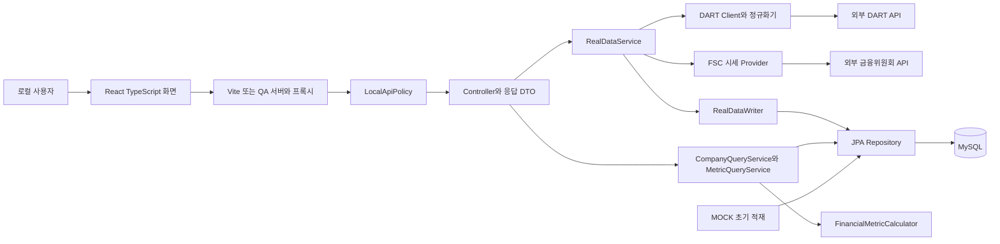
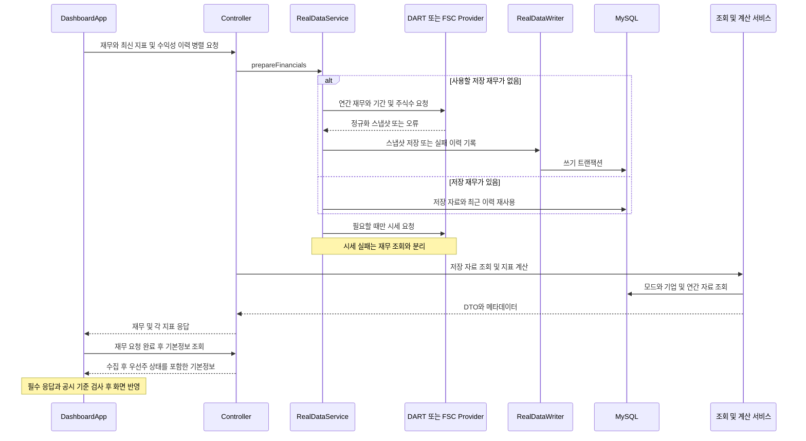
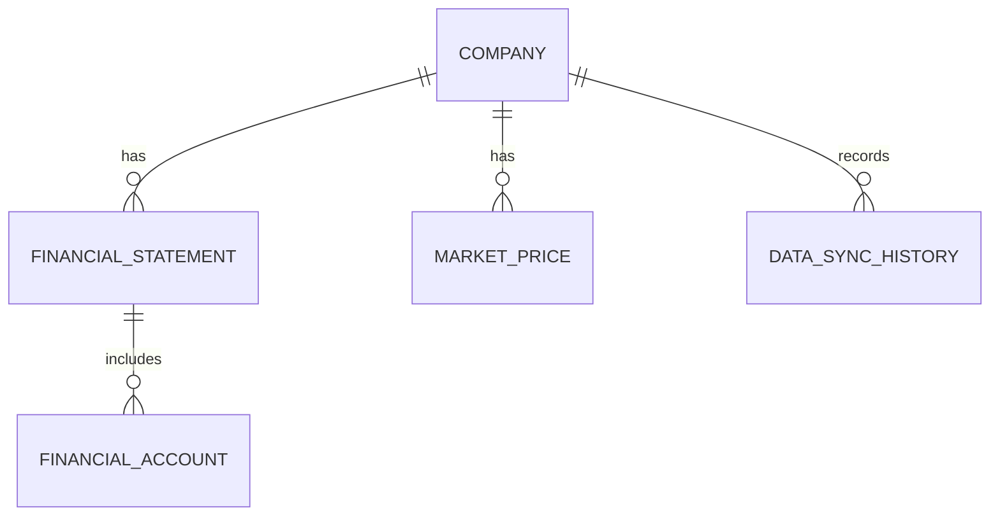
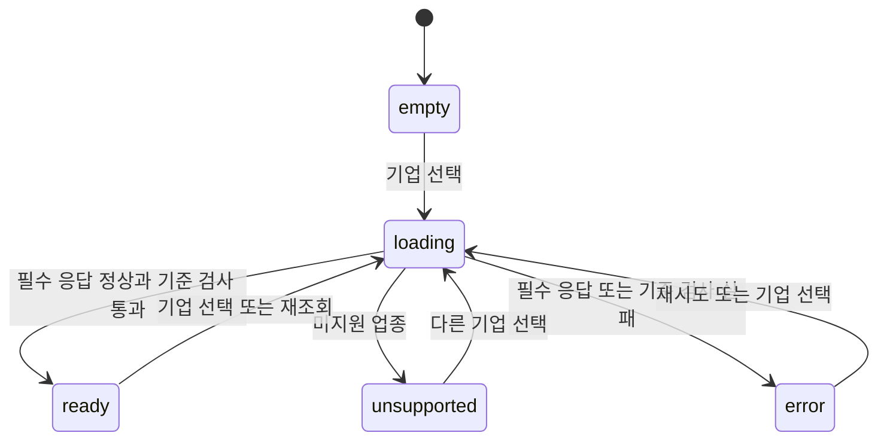

# Stock Insight 2.0 — 소프트웨어 설계 명세서(SDD)

| 항목 | 내용 |
|---|---|
| 문서 식별자 | SI-SDD-001 |
| 문서 버전 | 1.1 |
| 작성·기준일 | 2026-11-17 |
| 대상 소프트웨어 | Stock Insight 2.0, 백엔드·프론트엔드 0.6.0 |
| 설계 기준 | 현재 구현을 설명하는 현행 설계 명세(As-built) |
| 실행 대상 | Windows 로컬 PC, 단일 사용자 중심 |
| 독자 | 개발자·유지보수 담당자·프로젝트 검토자 |

## 목차

1. [문서 개요](#1-문서-개요)
2. [시스템 범위와 제약](#2-시스템-범위와-제약)
3. [요구사항과 유스케이스](#3-요구사항과-유스케이스)
4. [전체 아키텍처](#4-전체-아키텍처)
5. [모듈 상세 설계](#5-모듈-상세-설계)
6. [처리 흐름과 동시성](#6-처리-흐름과-동시성)
7. [데이터와 영속성](#7-데이터와-영속성)
8. [API와 외부 인터페이스](#8-api와-외부-인터페이스)
9. [금융 데이터와 계산 설계](#9-금융-데이터와-계산-설계)
10. [화면과 상태 관리](#10-화면과-상태-관리)
11. [오류·보안·품질 설계](#11-오류보안품질-설계)
12. [실행·설정·운영](#12-실행설정운영)
13. [검증과 요구사항 추적](#13-검증과-요구사항-추적)
14. [설계 결정·위험·변경 관리](#14-설계-결정위험변경-관리)
15. [참조 문서와 개정 이력](#15-참조-문서와-개정-이력)

## 1. 문서 개요

### 1.1 목적과 적용

본 문서는 국내 상장사의 연간 재무자료와 투자지표를 조회하는 Stock Insight의 구조, 구성요소별 책임, 데이터·API 계약, 주요 처리 절차와 운영 조건을 정의한다. 개발자가 변경의 영향 범위를 파악하고 검토자가 요구사항과 구현·검증 근거를 연결할 수 있도록 작성했다.

SDD는 Software Design Description의 약어다. 기술 설계 내용도 함께 담아 구현과 유지보수의 기준을 제공한다.

- 아래 요구사항 ID는 기존 기능을 추적하기 위해 부여했다. 새로운 기능이나 성능 목표를 추가하는 문서가 아니다.
- 금융 공식·세부 N/A 조건은 [금융 정책 5.3](../stock-insight-backend/docs/financial-policy.md#53-지표-기준표)을 기준으로 한다. 본 문서는 계산 책임과 불변 조건을 설명한다.
- API 필드·제약은 [API 명세](../stock-insight-backend/docs/api.md)·응답 DTO, 물리 스키마는 Flyway SQL을 함께 확인한다. 문서와 코드 사이의 차이는 수정 대상이다.
- 현재 구현, 기존 검증 결과, 미구현·미검증 항목을 구분한다. **사용자의 3종목 DART 공시 직접 대조는 미확인**이다.

### 1.2 주요 용어

| 용어 | 정의 |
|---|---|
| MOCK / REAL | 가상 학습 자료 / 실제 DART·금융위원회 자료를 사용하는 모드 |
| CFS / OFS | 연결재무제표 / 별도재무제표 |
| 사업연도 | 공시에서 확인한 연간 회계기간의 기준 연도 |
| 스냅샷 | 특정 사업연도·보고서 종류·기준으로 저장한 재무 또는 특정 기준일의 시세 |
| 정규화 | 공급원 계정·기간·주식수를 앱의 표준 계정과 메타데이터로 변환하는 처리 |
| N/A | 미수집 또는 산출 불가. 숫자 0과 구분하고 상태·사유로 설명 |
| stale | 재무·시세 중 최신 수집 이력에 실패가 있음을 나타내는 메타 값. 자료의 나이로 판정하는 값은 아님 |
| sync | API로 명시적으로 요청하는 기업·재무·시세 갱신 |

## 2. 시스템 범위와 제약

### 2.1 제공 범위

기업명·6자리 종목코드 검색, 기업 기본정보, 최대 5개년 연간 재무, 최신 연간 10개 지표, 연도별 영업·순이익률을 제공한다. 화면은 검색 목록과 대시보드로 구성하며 기업개요·재무정보·현금흐름·투자지표의 4개 탭을 제공한다.

REAL은 DART에서 기업·재무·기간·주식수 자료를, 금융위원회 주식시세정보 V2에서 보통주 종가·시가총액을 수집한다. 키 없이 재현하는 MOCK과 실패를 주입하는 QA 실행 환경을 제공한다. 저장 원본 조회·명시적 갱신은 REAL 전용 API다.

### 2.2 제외 범위

금융업 재무 분석, 분기·반기·TTM, 실시간 시세, 자동 최신 거래일 갱신, 자동 정정 공시 추적, 주식 분할에 따른 과거 EPS 자동 보정은 구현하지 않았다. 별도 KRX Client, 사용자 계정·인증, 인터넷 공개 배포, 다중 서버, 작업 큐, Redis, Actuator, Testcontainers도 현재 범위에 없다.

### 2.3 기술·운영 제약

| 항목 | 현재 설계·제약 |
|---|---|
| 백엔드 | Java 21, Spring Boot 3.5.16, Gradle Wrapper 8.10.2 |
| 프론트엔드 | React 19.3.1, TypeScript 7.0.2, Vite 8.3.8, Tailwind CSS 4.3.5, Recharts 3.10.1 |
| DB | MySQL 필수. 현재 PC native 8.0.46 검증, Compose 정의 8.4.13 |
| 실행 환경 | Node 24 이상, Windows PowerShell 실행 스크립트 제공 |
| 접근 경계 | 백엔드와 제공 화면 서버는 로컬 loopback에서 사용 |
| 외부 연동 | DART 키 필요. FSC 키가 없으면 시세·관련 지표 제공에 제한 |
| 수집 동시성 | 단일 JVM의 synchronized 수집 조정. 다중 서버 잠금이 아님 |
| 최신성 | 저장 자료 재사용. 수집 성공만으로 현재 최신 공시·거래일을 보장하지 않음 |

의존성은 [build.gradle](../stock-insight-backend/build.gradle), [package.json](../stock-insight-frontend/package.json)·[package-lock.json](../stock-insight-frontend/package-lock.json)으로 재현한다.

## 3. 요구사항과 유스케이스

### 3.1 기능 요구사항

| ID | 요구사항 | 주요 수용 조건 |
|---|---|---|
| FR-01 | 기업 검색·선택 | 기업명·코드로 검색하고 결과에서 선택. 빈 목록과 오류 구분 |
| FR-02 | 기업 기본정보 | 코드·시장·업종·결산월·우선주 확인 상태와 시세 기준 정보 제공 |
| FR-03 | 연간 재무 | 최신 확보 연도부터 최대 5개년. CFS 우선·OFS 대안과 실제 기간 보존 |
| FR-04 | 원본 추적 | 표준 계정에 원본 ID·이름·상세·금액 연결, 정규화 경고 제공 |
| FR-05 | 최신 지표 | 10개 지표와 공식·설명·사용 계정·N/A 사유를 백엔드에서 제공 |
| FR-06 | 수익성 이력 | 영업·순이익률을 재무와 같은 연도·기준·공시로 제공 |
| FR-07 | 대시보드 탐색 | 요약·4개 탭·차트/표 전환·연결/별도 선택 제공 |
| FR-08 | 모드 분리 | MOCK·REAL 구분. REAL 실패를 가상값으로 대체하지 않음 |
| FR-09 | 수집·재사용 | 필요한 REAL 자료를 최초 수집하고 재조회 시 저장 자료 활용 |
| FR-10 | 갱신·실패 보존 | sync의 재무·시세 outcome 개별 반환, 실패 시 정상 자료 보존 |
| FR-11 | 부분 실패·재시도 | 선택 지표·이력 오류에도 정상 재무 유지, 재조회 경로 제공 |
| FR-12 | 범위·상태 구분 | 실제 0·음수·누락·산출 불가·미지원 업종 구분, 출처·기간 표시 |
| FR-13 | API 자동 문서 |Swagger UI·OpenAPI 제공, 모드별5/7개 경로·파라미터·문자열 수치·오류 계약 표시 |

### 3.2 비기능 요구사항

| ID | 요구사항 | 구현 또는 확인 경계 |
|---|---|---|
| NFR-01 | 수치 정밀도 | BigDecimal·DECIMAL·문자열 JSON. 표시 변환으로 원본 변경 금지 |
| NFR-02 | 응답 일관성 | 기업·모드·연도·기준·접수번호·기간 교차 검사, 이전 요청 취소 |
| NFR-03 | 저장 무결성 | FK·Unique·CHECK, Flyway와 JPA validate |
| NFR-04 | 외부 실패 격리 | 시간·크기 제한, 재호출 완화, 재무·시세 결과 분리 |
| NFR-05 | 로컬 보안·비밀 관리 | 로컬 요청 경계, 서버 키 보관, 내부 예외·요청 URL 비노출 |
| NFR-06 | 재현·유지보수 | 책임 분리, 테스트·실행 스크립트, 원본·메타 보존 |
| NFR-07 | 사용성 | 키보드·도움말·본문 바로가기·표 대안. 390px 검사 수행, 접근성 전체 인증은 아님 |
| NFR-08 | 성능·자원 제한 | 차트 지연 로드, DB 풀 5개·연결 대기 5초. 처리량·p95·SLA 미정 |

### 3.3 주요 유스케이스

| ID | 주체·선행 조건 | 정상 흐름 | 예외·대체 흐름 |
|---|---|---|---|
| UC-01 | 로컬 사용자, 앱 실행 | 검색 → 목록 → 기업 선택 | 검색 실패는 재시도, 빈 목록은 검색어 수정 |
| UC-02 | 기업 선택 | 재무·지표·이력 요청 → 재무 완료 후 기본정보 → 기준 검사 → 탭 탐색 | 금융업은 미지원, 필수 응답 실패는 오류, 선택 응답 실패는 해당 영역만 안내 |
| UC-03 | REAL, 키·외부망 준비 | 미수집 자료 수집 → 정규화 → 저장 → 응답 | 최초 재무 실패는 오류. 시세 실패는 재무 분석 유지 |
| UC-04 | REAL 기업, 로컬 API 사용자 | POST sync → 기업 확인 → 재무·시세 수집 → outcome 확인 | 실패 이력 기록, 정상 스냅샷 보존 |
| UC-05 | REAL 원본 저장됨, 로컬 API 사용자 | 연도·basis 지정 → source 조회 → 근거 확인 | 기업·원본 없음은 404. 새 수집을 시작하지 않음 |

UC-04·05는 API 기능이다. 일반 화면의 `다시 불러오기`는 조회 재시도이며 강제 sync와 같은 동작으로 간주하지 않는다.

## 4. 전체 아키텍처

브라우저는 동일 화면 서버의 `/api/v1`을 호출하고 프록시는 로컬 Spring Boot로 전달한다. 인증키는 브라우저를 거치지 않고 백엔드 Provider에서 사용한다. 프론트는 DB에 직접 연결하지 않는다.

Controller는 입력 검증·수집 준비·조회 호출·응답을 담당한다. Service는 조회·계산과 수집 조정·저장으로 책임을 나눈다. Repository·Entity는 영속성을 담당한다. 외부 공급원 DTO, Entity, 공개 API DTO를 구분한다.

계산 엔진은 전달받은 계정·기간·주식수·시세를 계산하며 외부 HTTP·DB 쓰기를 담당하지 않는다. 프론트는 결과 표시와 사용자 탐색·요청 상태를 관리한다. 별도 API Gateway·메시지 브로커·마이크로서비스는 없다.

## 5. 모듈 상세 설계

### 5.1 백엔드

경로는 [백엔드 Java 루트](../stock-insight-backend/src/main/java/com/stockinsight/) 기준이다.

| 모듈·주요 클래스 | 입력 → 출력 | 책임 |
|---|---|---|
| api/CompanyController | 검색어·코드·years → 기업·재무 Envelope | 입력 검사, REAL 준비 후 조회 |
| api/MetricController | 코드·years → 최신 지표·이력 | 공통 계산·수집 경로 재사용 |
| api/RealDataController | 코드·연도·basis → outcome·원본 | real 프로필에서만 등록 |
| api/LocalApiPolicy | Host·Origin·Fetch Metadata → 허용/403 | `/api/**` 컨트롤러 실행 전 검사 |
| api/ApiExceptionHandler | 예외 → 공통 오류 | 공개 오류와 내부 원인 분리 |
| api/OpenApiConfig |Controller·DTO·모드 → OpenAPI |공통 정보·오류·모드별 입력 예시·상대 서버 주소 |
| service/CompanyQueryService | 모드·검색 조건·코드 → DTO·메타 | 검색·기간 선택·출처·stale 구성 |
| service/MetricQueryService | 연간 자료 → 지표 DTO | 계산 엔진 호출, 결과 비저장 |
| service/FinancialMetricCalculator | 계정·기간·주식수·시세 → MetricValue | BigDecimal 계산·검증·상태/사유 |
| service/RealDataService | 조회 준비·갱신 → 저장 준비·outcome | synchronized 조정, 저장 재사용·5분 이력 검사 |
| service/RealDataWriter | 스냅샷·실패 정보 → DB 변경 | 쓰기 트랜잭션·중복/정정 처리·이력 |
| provider/dart/DartClient | 기업·연도 등 → 외부 DTO | DART 호출·목록 캐시·ZIP/XML 해석 |
| provider/dart/DartFinancialDataProvider | 기업 → 개황·재무 스냅샷 | 연도·CFS/OFS·공시 식별 선택 |
| provider/dart/DartNormalizer | DART 응답 → 계정·메타·원본 | 모호한 계정·기간·보통주 범위는 경고·결측 처리 |
| provider/fsc/FscMarketDataProvider | 기업 → 선택적 시세 | 보통주 시세·기준일·출처 검증 |
| provider/ExternalHttp | 요청 구성·크기 한도 → bytes | 시간/크기 제한·리다이렉트 미추적·오류 정제 |
| service/MockSeedService·Mock Providers | 가상 정의 → MOCK 자료 | 키 없이 고정 사례 적재·조회 |
| domain/·repository/ | Entity·조건 → 저장·조회 결과 | JPA 매핑·쿼리. 물리 제약은 SQL로 관리 |

Provider 계약은 [FinancialDataProvider](../stock-insight-backend/src/main/java/com/stockinsight/provider/FinancialDataProvider.java)·[MarketDataProvider](../stock-insight-backend/src/main/java/com/stockinsight/provider/MarketDataProvider.java)다. enum의 KRX 항목은 KRX 연동이 구현됐다는 의미가 아니다.

### 5.2 프론트엔드

| 모듈 | 책임 |
|---|---|
| [main.tsx](../stock-insight-frontend/src/main.tsx)·[App.tsx](../stock-insight-frontend/src/App.tsx) | React 진입·앱 연결 |
| [DashboardApp.tsx](../stock-insight-frontend/src/DashboardApp.tsx) | 검색·선택·취소·필수/선택 응답 판정·상태 전이 |
| [api.ts](../stock-insight-frontend/src/lib/api.ts) | 동일 출처 fetch·공통 오류·loadDashboard 요청 순서 |
| [api-contract.ts](../stock-insight-frontend/src/lib/api-contract.ts)·[types.ts](../stock-insight-frontend/src/lib/types.ts) | 런타임 검사·정적 TypeScript 계약 |
| [Dashboard.tsx](../stock-insight-frontend/src/components/Dashboard.tsx) | 탭·요약·카드·표·차트 기준 선택·출처 |
| [FinancialChart.tsx](../stock-insight-frontend/src/components/FinancialChart.tsx) | Recharts 시각화·지연 로드 |
| [finance-view.ts](../stock-insight-frontend/src/lib/finance-view.ts)·[dashboard-view.ts](../stock-insight-frontend/src/lib/dashboard-view.ts) | 문자열/BigInt 표시·기간 일치 검사·차트 자료 |
| [InfoTooltip.tsx](../stock-insight-frontend/src/components/InfoTooltip.tsx) | 마우스·키보드·터치 설명 |

## 6. 처리 흐름과 동시성

### 6.1 기업 선택과 REAL 최초 수집

프론트 요청은 병렬이지만 REAL 수집 조정 메서드는 한 JVM에서 직렬화된다. 기본정보는 재무 요청이 성공 또는 실패로 끝난 뒤 요청한다. 최초 수집에서 갱신된 우선주 상태와 계산값의 불일치를 막고, 미지원 업종에서도 기본정보를 표시하기 위한 순서다.

### 6.2 저장 재사용과 갱신

| 대상 | 일반 조회 | 명시적 sync |
|---|---|---|
| 기업 목록·개황 | 저장된 정확한 종목코드는 재사용. 이름 검색은 DART 목록도 확인 | 개황 재확인 |
| DART 고유번호 목록 | 정상 목록을 메모리에서 1일 재사용 | 프로세스 캐시 정책은 동일 |
| 연간 재무 | 있으면 재사용, 없으면 수집 | 재수집 시도 |
| 최초 재무 실패·자료 없음 | 최근 5분 이력을 재사용해 반복 호출 완화 | 일반 조회의 대기와 별개로 시도 |
| 시세 | 저장값 또는 최근 5분 이력이 있으면 재사용 | 강제 수집 시도 |

최초 재무 실패 이력이 재사용되면 대응 오류를 반환한다. 성공 이력이 있으나 자료가 없는 경우는 결측 응답이다. 저장 자료 재사용은 최신성 보증이나 백그라운드 갱신 기능이 아니다.

### 6.3 트랜잭션과 실패

외부 HTTP는 쓰기 트랜잭션 밖에서 수행한다. `RealDataWriter`의 기업·재무·시세·실패 이력 메서드가 각각 트랜잭션을 연다. 정상 재무 저장은 계정·메타·원본·성공 이력을 함께 반영한다. 외부 수집 실패는 정상 스냅샷을 삭제하지 않고 실패 이력을 별도로 기록한다.

재무와 시세 갱신은 전체 원자적 작업이 아니다. 한쪽만 성공할 수 있어 sync의 `outcomes`를 각각 확인해야 한다. 기업 정보 수집 실패도 가능한 범위에서 시세 처리와 분리한다. 예상하지 못한 DB·내부 오류까지 모두 outcome으로 바꾸지는 않는다.

동일 연도·기준의 오래된 접수번호가 새 저장본을 덮어쓰지 않도록 검사한다. 같은 키의 갱신은 기존 스냅샷과 같은 표준 계정의 ID를 유지하며 값·메타·원본을 갱신한다. 새 계정은 추가하고 새 응답에서 사라진 계정은 제거한다. OFS 전환과 기존 CFS 정리는 접수번호 비교를 따른다. 모든 개정본을 별도 버전 테이블에 누적하는 구조는 아니다.

## 7. 데이터와 영속성

### 7.1 논리 관계

### 7.2 테이블과 식별

| 테이블 | 저장 내용 | 주요 제약 |
|---|---|---|
| company | 종목·DART 코드·시장·업종·결산월·우선주 확인 상태·모드 | PK id. Unique `(data_mode, stock_code)`, `(data_mode, corp_code)` |
| financial_statement | 연도·11011·기준·접수번호·기간·주식수·원본·진단 | FK company. Unique `(company_id, fiscal_year, report_code, basis)` |
| financial_account | 표준 계정·금액·원본 ID/이름/상세/금액 | FK statement. Unique `(statement_id, standard_code)` |
| market_price | 종가·시가총액·각 기준일·출처·통화·수집 시각 | FK company. Unique `(company_id, close_price_as_of, close_price_source)` |
| data_sync_history | FINANCIALS/MARKET·SUCCESS/FAILED·시각·건수·오류 | FK company. 기업·종류·완료 시각 인덱스 |

PK는 BIGINT AUTO_INCREMENT, 관계는 물리 FK다. 금융 계정·종가는 DECIMAL(30,6), 시가총액은 DECIMAL(30,0), 주식수는 BIGINT다. 날짜는 DATE, 수집 시각은 UTC DATETIME(6), 문자열은 utf8mb4다. 금액을 화면 단위인 억 원으로 저장하지 않는다.

`has_preferred_shares`의 NULL은 미확인이며 미발행으로 취급하지 않는다. 종가 양수, 시가총액과 메타의 동반 존재, 기간·수집 완료 시각 순서 등은 SQL CHECK로도 검사한다. 별도 이름 검색 엔진은 없다.

### 7.3 보존·마이그레이션

V1은 5개 업무 테이블을 생성한다. V2는 `raw_payload LONGTEXT NULL`, `normalization_notes TEXT NULL`을 재무 스냅샷에 추가한다. 적용된 V1·V2를 수정하지 않고 후속 변경은 새 마이그레이션으로 추가한다. 시작 시 Flyway가 적용하고 JPA는 `ddl-auto=validate`로 검사한다. Flyway clean은 비활성화한다.

원본에는 재무·기간·주식수·공시 식별정보를 보존하며 키·요청 헤더·전체 요청 URL은 넣지 않는다. 지표 결과 테이블은 없다. DB 파일은 종료·재실행 사이에 보존하지만 자동 백업·복구나 보존 기간 정책은 구현하지 않았다.

전체 컬럼·NULL·인덱스·갱신 규칙은 [DB 명세](../stock-insight-backend/docs/database.md), 물리 정의는 [V1](../stock-insight-backend/src/main/resources/db/migration/V1__create_initial_schema.sql)·[V2](../stock-insight-backend/src/main/resources/db/migration/V2__retain_source_documents.sql)를 참조한다.

## 8. API와 외부 인터페이스

### 8.1 공개 로컬 API

기본 경로는 `/api/v1`이다. DB PK 대신 종목코드를 입력하며 모든 `stockCode`는 숫자 6자리다. 성공·실패 모두 `data`, `meta`, `error`의 공통 Envelope를 사용한다.

| 메서드·경로 | 입력·제약 | 응답 data |
|---|---|---|
| GET /companies | query 필수 1~100자, limit 기본20·1~50 | CompanySummary 배열 |
| GET /companies/{stockCode} | 숫자 6자리 | CompanyDetail |
| GET /companies/{stockCode}/financials | years 기본5·1~5 | Financials |
| GET /companies/{stockCode}/metrics | 숫자 6자리 | Metrics, 최신 연간 10개 지표 |
| GET /companies/{stockCode}/metrics/profitability | years 기본5·1~5 | ProfitabilityHistory |
| POST /companies/{stockCode}/sync | REAL 전용, 숫자 6자리 | CollectionResult·재무/시세 outcomes |
| GET /companies/{stockCode}/financials/{year}/source | REAL 전용, year 2015~2100, basis 기본CFS·CFS/OFS | 저장 원본 JSON |

### 8.2 응답 계약

| 구분 | 계약 |
|---|---|
| 성공 | `data`에 결과, `error=null` |
| 실패 | `data=null`, `error.code/message/fields`로 안내 |
| meta | mode·sources·collectedAt·financialPeriods·market·stale |
| 기간 메타 | fiscalYear·reportCode·basis·receiptNo·filedAt·periodStart/End·source·collectedAt |
| 시세 메타 | 종가·시가총액 각각의 기준일·출처, collectedAt, COMMON_STOCK 범위 |
| 금액·지표·주식수 | JSON 문자열, N/A 값은 null |
| 지표 | code·value·unit·status·reasonCode·reason·formula·usedAccounts·explanation·naConditions·basisNote·priceAsOf |

`AVAILABLE`, `NOT_COLLECTED`, `NOT_APPLICABLE`, `UNSUPPORTED` enum을 공유한다. 금융업 재무·지표는 미지원 배열 대신 422다. 일부 지표만 N/A인 상태와 HTTP 오류를 구분한다. 연간 자료가 없으면 200과 NOT_COLLECTED·빈 목록을 반환할 수 있다.

### 8.3 외부 공급원

| 공급원 | 프로젝트 연동 설정 | 처리 |
|---|---|---|
| DART | `https://opendart.fss.or.kr/api`, 고유번호·개황·공시 목록·재무·기간·주식수 | 11011·공시 식별 검사·목록 캐시·정규화 |
| 금융위원회 | `https://apis.data.go.kr/1160100/GetStockSecuritiesInfoService_V2`, `/getStockPriceInfo_V2` | 보통주 시세·기준일·출처 검사 |

프로젝트 설정을 설명하는 표이며 외부 서비스의 현재 가용성·승인 상태를 보증하지 않는다. base URL 등은 주입해 로컬 upstream 테스트 서버로 대체할 수 있다. FSC는 해당 서비스 활용 승인을 받은 공공데이터포털 Decoding 키를 사용한다.

상세·예시는 [API 명세](../stock-insight-backend/docs/api.md), Java 계약은 [ApiModels](../stock-insight-backend/src/main/java/com/stockinsight/api/ApiModels.java)·[MetricModels](../stock-insight-backend/src/main/java/com/stockinsight/api/MetricModels.java)를 참조한다.

### 8.4 Swagger UI·OpenAPI

springdoc-openapi-starter-webmvc-ui 2.10.0으로 업무 Controller에서 OpenAPI 3.0 명세를 생성한다. 기본 경로는 `/swagger-ui.html`, `/v3/api-docs`, `/v3/api-docs.yaml`이다. MOCK은5개, REAL은 관리 API를 포함한7개를 노출한다. 문서용 경로는 업무 API7개에 합산하지 않는다.

DTO의 금액·주식수는 string·nullable로 문서화한다. 공통 오류 예시와 모드별 검색어·종목 예시를 제공한다. 서버 URL은 `/`을 사용해 Swagger를 연 백엔드 포트로 호출한다. 문서 조회만으로 수집을 실행하지 않으며 Try it out·Execute는 사용자가 명시적으로 누른다.

UI 자원은 백엔드에 포함하고 외부 validator를 사용하지 않는다. 문서·UI 경로에도 LocalApiPolicy를 적용한다. 상세 실행과 파일 스냅샷은 [Swagger 안내](../stock-insight-backend/docs/swagger-guide.md)를 참조한다.

## 9. 금융 데이터와 계산 설계

### 9.1 정규화 불변 조건

1. 연간 11011만 사용한다. 최신 확인 공시 연도부터 이전 4년 범위에서 수집하며 결측 연도를 오래된 값으로 채우지 않는다.
2. CFS 자료 없음일 때 OFS를 시도한다. 인증·한도·연결 오류를 CFS 없음으로 바꾸지 않는다.
3. 각 연도 보고서의 당기 금액을 사용한다. 후속 보고서의 전기·전전기 비교 금액으로 과거 스냅샷을 자동 덮어쓰지 않는다.
4. 공시 목록과 재무 응답 접수번호가 다르면 `DART_REVISION_PENDING`으로 중단한다. 기간·단위·범위가 불확실하면 추정하지 않는다.
5. 모호한 계정은 미매핑·경고로 남긴다. IS/CIS의 동일 항목 한 쌍에 대한 제한된 중복 해소만 허용한다.
6. 일반적인 기본 EPS 계정이라는 이유만으로 보통주 범위를 확정하지 않는다. 불확실하면 EPS·연관 지표는 N/A다.

표준 계정은 매출·영업이익·당기순이익·지배주주 순이익·자산·부채·자본·지배주주 지분·3개 현금흐름·기본 EPS의 12개다. 정확한 코드는 [DataTypes.StandardAccount](../stock-insight-backend/src/main/java/com/stockinsight/domain/DataTypes.java)에 있다.

### 9.2 계산 책임과 정책

최신 코드는 REVENUE_GROWTH, OPERATING_MARGIN, NET_MARGIN, ROE, ROA, DEBT_RATIO, EPS, BPS, PER, PBR이다. 이력은 각 연도의 OPERATING_MARGIN·NET_MARGIN만 같은 엔진으로 계산한다. 과거 PER·PBR은 생성하지 않는다.

공식·사용 계정·분모 조건은 **[금융 정책 5.3](../stock-insight-backend/docs/financial-policy.md#53-지표-기준표)**에 정의한다. 유지보수 시 아래 조건을 보존한다.

- ROE는 지배주주 기준이며 ROE·ROA는 기말 기준이다. 평균 기준으로 임의 변경하지 않는다.
- EPS는 공시된 보통주 기본 EPS이며 직접 추정하지 않는다.
- BPS는 승인된 조건부 계산이다. 우선주 미발행 확인·같은 결산일의 자기주식 제외 유통보통주식수·공시 근거를 요구한다. CFS/OFS의 순자산 계정 선택은 정책을 따른다.
- PER·PBR은 재무 연도와 시세 기준일을 함께 표시한다. 시세가 없다고 재무 기반 지표까지 제거하지 않는다.
- 확인된 0·음수는 결측이 아니다. 이를 분모로 사용하는 지표는 별도 검사한다.

### 9.3 정밀도·상태

계산은 BigDecimal, 결과는 소수 6자리 HALF_UP이다. 공시 EPS는 입력 정밀도를 보존한다. PBR은 중간 BPS 표시값 반올림의 영향을 피하도록 반올림 전 근거로 계산한다. JSON 수치는 문자열이고 프론트는 문자열·BigInt로 표시 변환한다. 차트 좌표만 Number 근사값을 사용한다.

N/A는 null·status·reasonCode·한국어 reason이다. 문제가 여러 개이면 검사 순서에 따라 한 사유가 선택될 수 있다. 서로 다른 연도·CFS/OFS·기간·통화를 섞거나 결측을 0으로 채우지 않는다. PERCENT의 15는 15%이며 화면에서 100을 다시 곱하지 않는다.

## 10. 화면과 상태 관리

### 10.1 표시 구성

| 영역 | 설계 |
|---|---|
| 검색 | 기업명·코드, 로딩·오류·빈 결과·선택 목록 구분 |
| 요약 | 기업·시장·업종·결산월·확보 연도, 매출·이익 카드 |
| 기업개요 | 기본정보·우선주 확인 상태·시세와 기준 정보 |
| 재무정보 | 손익/재무상태 전환, 차트·표, 매출·이익률 보조축 |
| 현금흐름 | 영업·투자·재무활동 차트·표·설명 |
| 투자지표 | PER·PBR·ROE·ROA·EPS·BPS·부채비율 7개 카드·표·근거 |
| 출처 | 모드·재무 기준·시세 기준일·수집 시각·공시 정보·경고 |

10개 지표를 화면 용도에 따라 요약·차트·7개 투자 카드로 나누어 사용한다. 차트는 선택한 CFS/OFS만 표시하고 결측 구간을 선으로 연결하지 않는다. 표·툴팁으로 원본 금액도 확인한다.

### 10.2 선택 상태

검색은 선택 상태와 별도로 관리한다. ready 안에서도 지표·이력은 null과 영역별 오류일 수 있다. 기본정보·재무는 필수, 지표·이력은 선택 응답이다.

### 10.3 이전 응답 차단·계약 검사

검색·선택 각각 AbortController를 두고 새 요청 시 이전 요청을 취소한다. 반영 전에도 aborted 여부를 검사한다. 취소만으로 응답 순서를 보장한다고 가정하지 않는다.

런타임 계약으로 구조·상태·메타를 검사한다. 기업·모드가 맞아야 하며 지표의 연도·CFS/OFS·접수번호·기간이 재무와 일치해야 한다. 최신 증가율 비교에는 전년 메타도 포함한다. 선택 응답 불일치는 해당 영역을 차단하고 필수 응답 불일치는 전체 오류로 처리한다.

## 11. 오류·보안·품질 설계

### 11.1 오류 분류

| HTTP·상태 | 의미·처리 |
|---|---|
| 200·빈 결과/NOT_COLLECTED | 결과 없음·자료 미확보. 서버 오류와 구분 |
| 200·지표 N/A | 해당 값의 사유 표시 |
| 200·sync outcomes | 재무·시세별 성공 여부 검사 |
| 400 | 입력 누락·형식·범위 위반 |
| 403 | 로컬 요청 경계 위반 |
| 404 | 기업·경로·저장 원본 없음 |
| 405 | 지원하지 않는 메서드 |
| 422 | 금융업 재무·지표 미지원 |
| 502 | 외부 응답·연결·정정 불일치 등 |
| 503 | 키·인증·호출 제한·외부 요청 중단 등 |
| 504 | 외부 요청 시간 초과 |
| 500 | 내부 오류·저장 원본 해석 오류 등 |

공급원 오류 문구·스택·원인 예외·JDBC 주소를 그대로 공개하지 않는다. 프론트는 JSON·구조 오류도 처리하고 재시도 경로를 제공한다. 정상 저장본은 갱신 실패 후에도 기준일·수집일·stale과 함께 재사용할 수 있다.

### 11.2 보안·비밀

`LocalApiPolicy`는 `/api/**`에서 loopback Host·로컬 http/https Origin·Fetch Metadata를 검사한다. 외부 Host/Origin, `Origin: null`, cross-site를 거부하고 Origin 없는 로컬 CLI는 허용한다. `X-Content-Type-Options: nosniff`를 추가한다.

같은 정책은 `/v3/api-docs`·하위 경로·YAML, `/swagger-ui.html`·UI 자원에도 적용한다.

외부 웹페이지의 로컬 수집 실행을 줄이기 위한 경계이며 사용자 인증·권한·모든 로컬 프로세스의 신뢰 검증은 아니다. 공개 서비스로 전환하려면 인증·권한·TLS·요청 제한·배포 설정을 별도 설계해야 한다.

키는 서버 환경변수 또는 Git 제외 대상 `.env.real`에 둔다. 소스·번들·문서·공개 오류·원본에 기록하지 않는다. `.env`는 Spring Boot가 자동으로 읽지 않아 제공 스크립트 또는 IDE 파일 로딩 설정이 필요하다.

### 11.3 자원·응답 제한

외부 연결은 5초, 본문 수신을 포함한 개별 요청은 15초 제한이다. 호출별 응답 크기 상한을 전달하고 리다이렉트를 따라가지 않는다. DART ZIP/XML은 압축 해제·파싱 경계도 검사한다. DB 풀은 최대 5개·연결 대기 5초다.

최초 수집에는 외부 호출이 여러 개 포함된다. 개별 15초 제한은 화면 전체 응답 시간 보증이 아니다. 대규모 동시 수집·장시간 운영 성능은 미검증이다.

## 12. 실행·설정·운영

### 12.1 실행 구성

| 용도 | 화면 | 백엔드 | MySQL | 시작 |
|---|---|---|---|---|
| IntelliJ·VS Code |5173 |8080 |13397 |DB 명령 → IntelliJ Run → VS Code npm.cmd run dev |
| 가상 일괄 실행 |5194 |18094 |13394 |start-phase5-local.ps1 -Mode Mock |
| 실제 일괄 실행 |5195 |18095 |13395 |start-phase5-local.ps1 -Mode Real |
| QA·오류 주입 |5206 |18096 |13396 |start-quality-check.ps1 |

포트는 안내의 기본 구성이다. 전체 명령·IDE 인자·키 로딩은 [IDE 안내](ide-development-guide.md)·[PowerShell 안내](../stock-insight-frontend/docs/local-run-guide.md)에 둔다. 일괄 실행은 3종 서버를 모두 켜고 `start-ide-db.ps1`은 DB만 켠다.

MySQL Server는 MOCK에서도 필요하며 현재 PC에 설치되어 있다. Workbench는 선택 클라이언트다. IDE DB는 `work/ide-real/mysql-data`, 일괄 DB는 모드별 작업 폴더에 보존된다. IDE와 기존 Real DB 자료는 자동 공유·복사되지 않는다.

### 12.2 설정

| 설정 | 용도 |
|---|---|
| SPRING_PROFILES_ACTIVE·APP_DATA_MODE | mock/MOCK 또는 real/REAL 일관 선택 |
| DB_URL·DB_USERNAME·DB_PASSWORD | Spring datasource. IDE 인자는 안내에 따라 지정 |
| MYSQL_DATABASE·MYSQL_USER·MYSQL_PASSWORD·MYSQL_ROOT_PASSWORD·MYSQL_PORT | DB 스크립트·Compose 구성 |
| SERVER_PORT | 백엔드 포트. 래퍼·명시적 인자가 우선할 수 있음 |
| DART_API_KEY·FSC_API_KEY | 외부 공급원 인증 |
| API_PROXY_TARGET | Vite 대상, 기본 http://127.0.0.1:8080 |
| MYSQL_IT_* | 격리 DB 테스트용. 앱 운영 DB를 지정하지 않음 |

### 12.3 시작·종료·반영

IDE는 DB READY → 백엔드 시작 완료 → 프론트 시작 순서다. 종료는 프론트 Ctrl+C → IntelliJ Stop → DB Enter다. 일괄 실행은 창에서 Enter로 자신이 시작한 프로세스를 종료한다. 브라우저만 닫아서는 서버가 꺼지지 않는다.

DB·키를 보존하고 다음 실행에 재사용한다. Java·키 변경은 백엔드를 재시작한다. JAR 실행에서는 소스를 bootJar로 빌드해 반영한다. 프론트 개발 서버는 편집을 반영하며 QA는 dist를 사용해 변경 후 다시 빌드한다. 포트 충돌을 해결하려고 DB 폴더를 삭제하지 않는다.

## 13. 검증과 요구사항 추적

### 13.1 수준·기존 결과

V-BE부터 V-REAL은 기존 Phase6/7의 0.6.0 검증 기록이다. Swagger 추가 후 재실행은 V-SWAGGER로 구분한다. 재현·증거·제한은 [검증 안내](verification.md)에 있다.

| ID | 수준 | 기존 결과·확인 범위 |
|---|---|---|
| V-BE |백엔드 단위·웹·DB |217개 통과, 계산·공급원·MySQL·Flyway·보안 포함 |
| V-LIVE |저장 실응답 |실제 DART 응답 68개 테스트 사례. 새 인증 호출과 구분 |
| V-FE |프론트 계약·빌드 |21개 통과, TypeScript 검사·프로덕션 빌드 성공 |
| V-HTTP |패키지 HTTP |17개 정상·보안·오류 주입 검사 통과 |
| V-UI |브라우저 |15개 정상·부분 실패·복구·지연·390px 검사 통과 |
| V-REAL |실제 공급원 |DART·FSC 인증·수집 확인, 4기업 5개년 HTTP 회귀 |
| V-MANUAL |사용자 공시 대조 |기아·롯데케미칼·삼성전자 매출·영업이익·순이익·기본 EPS **미확인** |
| V-SWAGGER |Swagger 추가 후 회귀 |백엔드222개·실패/오류/건너뜀0. 모드별 명세·nullable 문자열·UI 제공·문서 보안5개 추가 검사 포함 |

V-BE의217개는 Phase6/7 당시 기록이며, V-SWAGGER는 API 문서 기능 추가 후 별도 재실행한 결과다. 현재 재현 명령의 전체 검사는222개다. [Swagger 검증 기록](../stock-insight-backend/docs/swagger-verification.json)에 최신 범위를 남긴다.

DB 환경 없이 `gradlew test`만 실행하면 통합 테스트를 건너뛴다. 전체 DB 검증은 `verify-mysql.ps1`로 임시 DB에서 수행한다. 로컬 upstream, 저장 실응답, 실제 외부 호출은 서로 다른 검증이다.

### 13.2 추적표

테스트 위치: [백엔드](../stock-insight-backend/src/test/java/com/stockinsight/)·[프론트 라이브러리](../stock-insight-frontend/src/lib/). HTTP·UI 증거는 [Phase 6 결과](../stock-insight-frontend/docs/phase-6-verification.md)를 참조한다.

| 요구사항 | 주요 구현 | 검증 |
|---|---|---|
| FR-01·02 |CompanyController·CompanyQueryService·검색 UI |V-BE: CompanyControllerTest·CompanyQueryServiceTest, V-UI |
| FR-03·04 |DART Provider·Normalizer·재무 Entity |V-LIVE, V-BE: ProviderContractTest·RealDataIntegrationTest |
| FR-05·06 |MetricQueryService·계산 엔진 |V-BE: FinancialMetricCalculatorTest·MetricQueryServiceTest·MetricControllerTest, V-LIVE |
| FR-07 |Dashboard·FinancialChart·표시 함수 |V-FE: dashboard-view.test.ts·finance-view.test.ts, V-UI |
| FR-08 |프로필·모드 조회·MockSeedService |V-BE: MockApiIntegrationTest·RealDataIntegrationTest, V-FE |
| FR-09·10 |RealDataService·Writer·수집 이력 |V-BE: RealDataIntegrationTest, V-REAL |
| FR-11·12 |선택 상태·N/A·오류 핸들러 |V-FE: api.test.ts·표시 테스트, V-BE, V-UI |
| FR-13 |OpenApiConfig·Controller/DTO 주석·springdoc |V-SWAGGER: MockApiIntegrationTest·RealDataIntegrationTest·LocalApiPolicyTest |
| NFR-01 |BigDecimal·DECIMAL·문자열·BigInt |V-BE 계산/통합, V-FE 표시 |
| NFR-02 |AbortController·samePeriods·계약 |V-FE: api.test.ts·dashboard-view.test.ts, V-UI 지연 전환 |
| NFR-03 |Flyway·FK/Unique/CHECK·validate |V-BE: MigrationUpgradeTest·DB 통합 |
| NFR-04 |ExternalHttp·5분 이력·결과 분리 |V-BE: ExternalHttpTest·RealDataIntegrationTest, V-HTTP·V-UI |
| NFR-05 |LocalApiPolicy·공개 오류·서버 키 |V-BE: LocalApiPolicyTest·외부 HTTP, V-HTTP·기존 보안 검사 |
| NFR-06 |모듈·원본·격리 실행·문서 |V-BE·V-LIVE·검증 재현 안내 |
| NFR-07 |키보드·표·반응형 |V-UI 일부 확인. 전체 접근성·모든 실제 단말 검사 미수행 |
| NFR-08 |차트 lazy load·풀/시간 제한 |V-FE 빌드·V-BE HTTP. 처리량·p95·장시간 부하 미검증 |

### 13.3 남은 확인

사용자 공시 대조는 [대조표](../stock-insight-backend/docs/live-verification-table.md)·[방법](../stock-insight-backend/docs/manual-verification.md)에 따라 별도 기록한다. 실제 휴대전화·다수 브라우저 전체·장시간 부하, Java 전체 의존성 SCA, 현재 PC Docker 엔진 경로는 완료로 표시하지 않는다. 당시 npm audit 취약점 0을 Java 의존성·향후 시점의 결과로 확대하지 않는다.

## 14. 설계 결정·위험·변경 관리

### 14.1 결정

단일 Spring Boot·MySQL은 현재 로컬 규모와 운영 단순성을 위한 선택이다. TypeScript와 런타임 검사는 정적 타입만으로 JSON을 보장할 수 없는 문제를 함께 다룬다. 요청 시 계산은 저장 결과의 이중 동기화를 피한다. 원본·엄격한 N/A는 표시 범위를 줄이는 대신 판단 근거를 보존한다.

대안·비용·채택 이유는 [설계 결정 기록](design-decisions.md)에 유지한다.

### 14.2 위험

| 위험·한계 | 현재 대응 | 남은 제한 |
|---|---|---|
| 공급원 장애·한도·키 |시간/크기 제한·오류·이력·정상본 보존 |최초 수집은 공급원 의존 |
| 오래된 자료 조회 성공 |기간·기준일·수집일·명시적 sync |stale=false도 최신성 보증 아님 |
| 계정·범위 모호성 |원본·경고·N/A |모든 기업의 모든 계정 미지원 |
| 우선주·주식수·EPS |근거 확인·엄격한 사유 |일부 기업 EPS/PER·BPS/PBR 제한 |
| 기업 전환 응답 혼합 |취소·반영 전 검사·메타 일치 |새 응답도 같은 검사 필요 |
| DB 손실·오삭제 |모드 분리·보존·clean 비활성 |자동 백업·복구 훈련 없음 |
| 사용자·수집량 증가 |synchronized 중복 완화 |기업별 잠금·큐·분산·부하 시험 없음 |
| 공개 전환 |현재 로컬 제한 |인증·TLS·요청 제한·운영 관측 별도 설계 필요 |

### 14.3 변경 시 동기화 대상

| 변경 | 함께 검토·수정 |
|---|---|
| 금융 공식·N/A |정책 5.3·엔진·기대값·실응답 테스트·API 설명·UI 도움말·영향 기업 |
| API 필드·메타 |DTO·Controller·API 명세·TS 타입·런타임 계약·프론트/HTTP 테스트 |
| DB 스키마 |새 Flyway·Entity/Repository·DB 명세/ERD·보존 테스트 |
| 수집·정규화 |Provider·Normalizer·원본·계약/실응답 테스트·오류/보존 |
| 포트·환경변수 |스크립트·설정·IDE/PowerShell 안내·SDD 실행표 |
| 범위·검증 |SDD 요구사항/추적표·README·검증 문서. 과거 결과와 새 실행 구분 |

자동 최신성, 기업별 잠금·큐, 백업·복구, 인증·공개 배포는 향후 검토 후보이며 구현·확정 일정이 아니다.

## 15. 참조 문서와 개정 이력

| 문서 | 역할 |
|---|---|
| [프로젝트 README](../README.md) |진입점·일반 실행·문서 목록 |
| [아키텍처](../stock-insight-backend/docs/architecture.md) |흐름·구현 개요 |
| [설계 결정](design-decisions.md) |이유·대안·비용 |
| [API 명세](../stock-insight-backend/docs/api.md) |필드·제약·오류·예시 |
| [Swagger 안내](../stock-insight-backend/docs/swagger-guide.md) |자동 명세·UI·모드별 호출·스냅샷 |
| [DB 명세](../stock-insight-backend/docs/database.md) |컬럼·관계·제약·갱신 |
| [금융 정책](../stock-insight-backend/docs/financial-policy.md) |공식·N/A·단위·정밀도 |
| [검증 안내](verification.md) |재현·증거·미검증 |
| [IDE 안내](ide-development-guide.md) |IntelliJ·VS Code·MySQL |
| [PowerShell 안내](../stock-insight-frontend/docs/local-run-guide.md) |일괄 시작·종료·재실행 |

| 버전 | 날짜 | 변경 |
|---|---|---|
| 1.0 |2026-11-17 |0.6.0 현행 SDD 최초 작성. 요구사항·모듈·데이터·API·상태·운영·검증 추적 통합 |
| 1.1 |2026-11-17 |Swagger UI·OpenAPI, FR-13·문서 보안·222개 회귀 검증 추가 |
