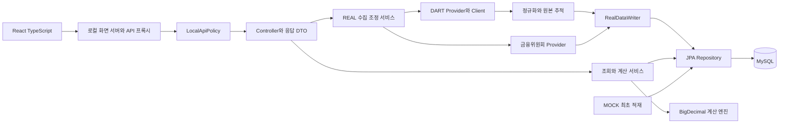
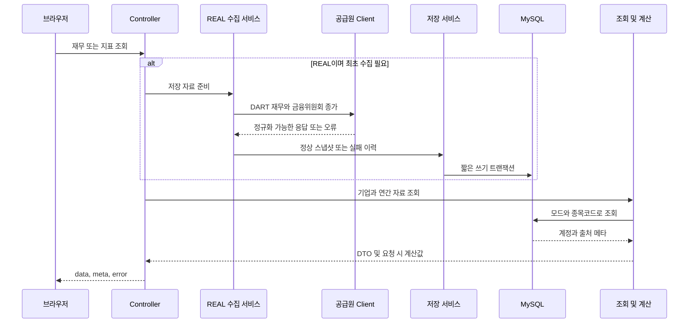

# 현재 아키텍처 — Stock Insight 0.6.0

Phase7에서 실제 구현을 기준으로 정리했습니다. 과거 단계별 결과는 각 검증 보고서에 남깁니다. 실제 DART·금융위원회 인증과 수집은 확인했으며, 사용자의 공시 화면 직접 대조는 미확인입니다.

## 구성과 경계

React는 검색·선택·상태·표시를 담당하고, Spring Boot는 수집·정규화·지표 계산·저장을 담당합니다. JPA는 자바 객체와 DB 테이블을 연결하고, Flyway는 순서가 있는 SQL 파일로 스키마를 관리합니다. 한 개 백엔드 애플리케이션과 MySQL로 구성하며 별도 마이크로서비스·Redis를 사용하지 않습니다.

개발 화면은 Vite 프록시를 사용합니다. QA 화면은 빌드한 dist를 제공하고 테스트 프록시에서만 오류를 주입합니다. 일반 앱에 QA 제어 코드를 넣지 않습니다. 데이터 정의와 DB 관계는 [DB 명세·ERD](database.md), 금융 기준은 [정책 문서](financial-policy.md)가 기준입니다.

## 요청 흐름

1. 브라우저가 기업명·종목코드를 검색합니다. Controller는 길이·형식·범위를 검사합니다.
2. MOCK은 저장된 가상 자료를 조회합니다. REAL은 필요한 기업 정보·재무·시세를 먼저 준비합니다.
3. 외부 Client가 응답을 받으면 전용 DTO로 해석합니다. 정규화기는 계정·사업연도·연결/별도·접수번호·기간을 확인합니다.
4. 정상 스냅샷과 원본을 트랜잭션으로 저장합니다. 외부 HTTP를 기다리는 동안 쓰기 트랜잭션을 열어 두지 않습니다.
5. 조회 서비스가 Entity를 응답 DTO로 변환합니다. Entity를 JSON에 직접 노출하지 않습니다.
6. 지표 서비스는 저장된 연간 계정과 메타를 계산 엔진에 넘깁니다. 계산값은 DB에 저장하지 않습니다.
7. 프론트엔드는 기업·모드·연도·기준·접수번호·기간을 맞춘 뒤 카드·차트·표를 표시합니다.

검색은 준비된 종목코드가 정확히 일치하면 재사용합니다. 이름 검색은 캐시 결과만으로 일치 기업 전체를 확보했다고 가정하지 않고 DART 목록도 확인합니다. 고유번호 목록은 하루 동안 메모리에 재사용합니다.

재무는 최초 수집 후 DB를 재사용합니다. 최초 실패 후 일반 조회는5분 동안 같은 실패 이력을 재사용합니다. 시세도 저장값 또는 최근 이력을 재사용하므로 최신 거래일을 자동 보장하지 않습니다. 명시적 `POST sync`가 기업·재무·시세 갱신을 요청합니다. 재무·시세 결과는 개별 outcome으로 확인합니다.

## 실제 수집과 정규화

- 재무 공급원은 DART, 시세 공급원은 금융위원회 V2 하나씩입니다. 실제 KRX Client를 구현한 것은 아닙니다.
- 최신 확인 사업보고서 연도에서 이전4개 사업연도까지 수집을 시도합니다. 없는 연도는 생략하며 더 오래된 연도로 채우지 않습니다.
- CFS 자료 없음일 때만 OFS를 시도합니다. 인증 오류·호출 제한을 자료 없음으로 바꾸지 않습니다.
- 해당 연도 보고서의 당기 금액을 사용합니다. 후속 보고서의 전기·전전기 금액으로 과거 스냅샷을 덮어쓰지 않습니다.
- 최신 공시 목록의 접수번호와 재무 응답 접수번호가 다르면 `DART_REVISION_PENDING`으로 중단합니다. 기간을 확인할 수 없으면 추정하지 않습니다.
- 표준 계정 후보가 모호하면 미매핑으로 남깁니다. 같은 ID·이름·상세·원금액의 IS/CIS 한 쌍만 제한적으로 중복 해소합니다.
- 보통주 범위가 확인되지 않은 기본 EPS를 임의 채택하지 않습니다. 원본과 정규화 경고를 함께 보존합니다.

원본 응답에는 인증키·요청 헤더·전체 요청 URL을 저장하지 않습니다. 실제 사례와 기대값은 [실응답 테스트 입력](../src/test/resources/dart-live/README.md), [사용자 공시 대조표](live-verification-table.md)에 연결합니다.

## 프론트엔드 상태와 정밀도

재무·최신 지표·이익률 이력은 병렬 요청합니다. 기업 기본정보는 최초 재무 수집이 우선주 상태를 갱신한 뒤 읽습니다. 기업을 바꾸면 이전 AbortController를 취소하고 결과 반영 전에도 취소 여부를 검사합니다.

재무·기업 정보는 필수이고, 최신 지표·이익률 이력은 부분 실패를 허용합니다. 잘못된 지표 응답이나 공시 불일치는 해당 영역만 N/A·오류로 처리합니다. TypeScript와 별도로 실제 JSON 구조를 검사합니다.

금액은 문자열·BigInt로 표시하고 차트 좌표만 Number 근사값을 씁니다. 지표 공식은 프론트엔드에서 다시 계산하지 않습니다. 차트는 선택한 연결/별도 기준만 표시하고 결측 구간을 선으로 잇지 않습니다. 차트 코드는 탭에서 필요할 때 지연 로드합니다.

## 데이터·보안 경계와 제한

- 검색·조회는 `(data_mode, stock_code)`로 분리합니다. REAL 실패에 Mock 자료를 대입하지 않습니다.
- HTTP는127.0.0.1에 바인딩합니다. LocalApiPolicy는 외부 Host·Origin·cross-site API 요청을 차단하며 사용자 인증 기능은 아닙니다.
- 외부 HTTP 연결5초·전체 요청15초 제한, 응답 크기 제한, 리다이렉트 미추적을 적용합니다. 오류 응답에 비밀값·원인 예외·JDBC 주소를 넣지 않습니다.
- REAL 수집 조정 메서드는 synchronized입니다. 한 로컬 앱의 중복 수집을 줄이는 단순한 선택이며 대규모 병렬 수집 구조는 아닙니다.
- Flyway V1·V2만 적용하고 JPA는 `ddl-auto=validate`로 검사합니다. 모니터링·인증·공개 배포는 구현 범위에 없습니다.

## 코드 위치

| 책임 | 파일·디렉토리 |
|---|---|
| HTTP·검증·공통 응답 | `src/main/java/com/stockinsight/api/` |
| 수집 조정·저장·조회·계산 | `src/main/java/com/stockinsight/service/` |
| 공급원 Client·DTO·정규화 | `src/main/java/com/stockinsight/provider/` |
| Entity·Repository | `domain/`, `repository/` |
| 스키마 | `src/main/resources/db/migration/` |
| 프론트 요청·상태 | `stock-insight-frontend/src/DashboardApp.tsx`, `src/lib/api.ts` |
| 프론트 표시·차트 | `src/components/`, `src/lib/dashboard-view.ts` |

기술 선택의 이유·대안·제약은 [설계 결정 기록](../../docs/design-decisions.md), 재현과 테스트는 [검증 안내](../../docs/verification.md)를 참조하세요.
