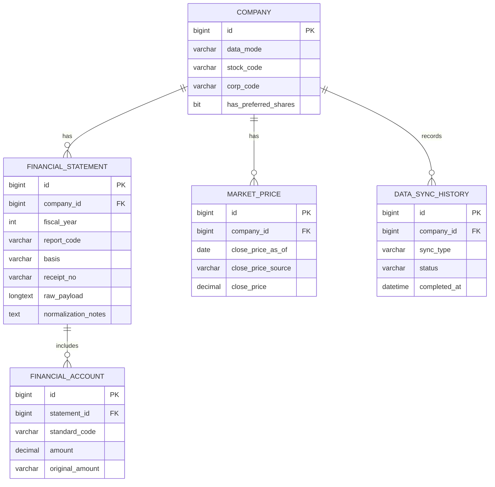

# DB 명세·ERD — 0.6.0

적용된 마이그레이션은 V1·V2입니다. V2는 financial_statement에 raw_payload LONGTEXT NULL과 normalization_notes TEXT NULL을 추가합니다.
기존 V1의 정의·금액·키는 변경하지 않습니다. 기존 금액·접수번호 보존을 실제 MySQL에서 검증했습니다.
두 컬럼에는 DART 원본 응답·공시 식별정보와 미매핑 진단을 보관합니다.
같은 연도·기준의 정정본은 계정 ID를 유지하면서 갱신합니다. 지표는 계속 저장하지 않습니다.
검증 상태와 상세 갱신 규칙은 [Phase 4 보고](phase-4-verification.md)를 참조하세요.

정확한 SQL은 [V1 테이블 생성](../src/main/resources/db/migration/V1__create_initial_schema.sql)과 [V2 원본 보존](../src/main/resources/db/migration/V2__retain_source_documents.sql)입니다. 이 문서는 현재 두 버전을 합친 스키마를 설명합니다.
모든 PK는 `BIGINT AUTO_INCREMENT`, 모든 FK는 물리 FK이며 자동 연쇄 삭제를 사용하지 않습니다.
날짜는 DATE, 수집 시각은 UTC DATETIME(6), 문자열은 utf8mb4입니다.
금액·EPS는 DECIMAL(30,6)이며 원본 문자열도 보존합니다. 화면 표시를 위해 원본을 억 원으로 바꾸어 저장하지 않습니다.

## ERD

그림은 주요 컬럼만 표시합니다. 복합 Unique·NULL·검사 제약과 갱신 방식은 아래 표 및 SQL이 기준입니다. 지표 결과 테이블은 없습니다.

## Company — 기업 검색과 지원 여부

| 컬럼 | SQL 타입 | 제약·목적 |
|---|---|---|
| id | BIGINT | PK |
| stock_code | VARCHAR(6) | NOT NULL, 사용자가 조회하는 종목코드 |
| corp_code | VARCHAR(8) | NOT NULL, DART 고유번호. Mock에서는 가상 식별자 |
| name | VARCHAR(100) | NOT NULL |
| market | VARCHAR(16) | NOT NULL, KOSPI/KOSDAQ/KONEX |
| industry_code | VARCHAR(16) | NOT NULL, Mock은 MOCK 접두어의 가상 코드 |
| industry_name | VARCHAR(100) | NOT NULL |
| fiscal_month | INT | NOT NULL, CHECK 1~12 |
| has_preferred_shares | BIT | NULL 가능. NULL은 미확인, false로 추정하지 않음 |
| supported | BIT | NOT NULL, 업종 지원 여부 |
| data_mode | VARCHAR(16) | NOT NULL, MOCK/REAL |
| source | VARCHAR(16) | NOT NULL |
| collected_at | DATETIME(6) | NOT NULL |

Unique: `(data_mode, stock_code)`, `(data_mode, corp_code)`.
이 인덱스로 모드와 종목코드의 단건 조회를 지원합니다. 이름 포함 검색은 MVP 데이터 규모에서 수행하며 대규모 검색 색인은 추가하지 않았습니다.
갱신: Mock은 최초 적재 후 유지. REAL은 최초 검색에서 기업 개황을 저장하고 명시적 sync에서 갱신합니다. 수집된 최신 재무 주식수로 우선주 상태를 확인하며, NULL은 계속 미확인으로 취급합니다.

## FinancialStatement — 연도·기준별 재무 스냅샷

| 컬럼 | SQL 타입 | 제약·목적 |
|---|---|---|
| id | BIGINT | PK |
| company_id | BIGINT | NOT NULL, FK → company.id |
| fiscal_year | INT | NOT NULL, 사업연도 |
| report_code | VARCHAR(5) | NOT NULL, CHECK 11011 |
| basis | VARCHAR(8) | NOT NULL, CFS/OFS |
| receipt_no | VARCHAR(64) | NOT NULL. Mock 접수번호는 MOCK- 접두어, 실제 DART 번호가 아님 |
| filed_at | DATE | NOT NULL, 공시일 |
| period_start / period_end | DATE | NOT NULL, CHECK 종료 ≥ 시작 |
| currency | VARCHAR(3) | NOT NULL |
| source | VARCHAR(16) | NOT NULL |
| collected_at | DATETIME(6) | NOT NULL |
| issued_common_shares | BIGINT | NULL 가능, 발행 보통주 |
| treasury_common_shares | BIGINT | NULL 가능, 자기 보통주 |
| outstanding_common_shares | BIGINT | NULL 가능, 공시의 유통 보통주 |
| preferred_shares | BIGINT | NULL 가능, 해당 기준일 우선주 발행 수량 |
| shares_as_of | DATE | NULL 가능, 주식수 기준일 |
| shares_receipt_no | VARCHAR(64) | NULL 가능, 주식수 근거 접수번호 |
| raw_payload | LONGTEXT | NULL 가능, V2 추가. 재무·기간·주식수·공시 식별 원본 JSON |
| normalization_notes | TEXT | NULL 가능, V2 추가. 미매핑·모호성·EPS/주식수 확인 경고 |

Unique: `(company_id, fiscal_year, report_code, basis)`.
이 복합 인덱스의 선두 컬럼으로 기업별 연도 조회를 지원합니다.
관계: 기업 N:1, 계정 1:N. Entity의 계정 저장·제거는 부모 스냅샷이 관리합니다.
갱신: Mock은 불변. REAL은 같은 연도·보고서·기준의 같거나 더 최신인 접수번호를 반영하고 더 오래된 입력은 무시합니다. 스냅샷·계정·원본을 한 트랜잭션으로 갱신합니다. 최신 OFS를 저장할 때 그보다 오래된 동일 연도 CFS가 계속 선택되지 않도록 정리합니다.
후속 보고서의 전기 수치로 과거 스냅샷을 자동 덮어쓰지 않습니다.
주식수는 같은 결산일·접수번호 근거를 보존합니다. 계산에 사용할 수 있는지는 [금융 정책](financial-policy.md)의 조건으로 판정합니다.

## FinancialAccount — 정규화된 재무 계정과 원본 정보

| 컬럼 | SQL 타입 | 제약·목적 |
|---|---|---|
| id | BIGINT | PK |
| statement_id | BIGINT | NOT NULL, FK → financial_statement.id |
| standard_code | VARCHAR(48) | NOT NULL, 12개 표준 계정 |
| amount | DECIMAL(30,6) | NULL 가능, 0과 누락 구별 |
| original_account_id | VARCHAR(256) | NOT NULL |
| original_account_name | VARCHAR(256) | NOT NULL |
| original_account_detail | VARCHAR(1000) | NULL 가능 |
| original_amount | VARCHAR(100) | NULL 가능, 변환 전 문자열 |

Unique: `(statement_id, standard_code)`.
단위는 표준 계정 enum에서 결정합니다. 일반 금액 KRW, BASIC_EPS는 KRW_PER_SHARE입니다.
원본 계정이 없는 Mock 사례는 해당 행을 만들지 않으며, 응답 DTO가 null과 NOT_COLLECTED로 표현합니다.
REAL에서 미매핑·모호한 계정은 이 표에 추정값을 만들지 않습니다. 원본 JSON은 부모의 raw_payload에 남기고 normalization_notes로 원인을 추적합니다. 응답은12개 표준 계정을 일관되게 제공하며 확보하지 못한 값은 NOT_COLLECTED입니다.
갱신: 부모 FinancialStatement의 계정 묶음과 함께 원자적으로 변경합니다.

## MarketPrice — 종가 스냅샷

| 컬럼 | SQL 타입 | 제약·목적 |
|---|---|---|
| id | BIGINT | PK |
| company_id | BIGINT | NOT NULL, FK → company.id |
| close_price | DECIMAL(30,6) | NOT NULL, CHECK > 0 |
| close_price_as_of | DATE | NOT NULL |
| close_price_source | VARCHAR(16) | NOT NULL |
| market_cap | DECIMAL(30,0) | NULL 가능 |
| market_cap_as_of | DATE | NULL 가능 |
| market_cap_source | VARCHAR(16) | NULL 가능 |
| currency | VARCHAR(3) | NOT NULL |
| collected_at | DATETIME(6) | NOT NULL |

Unique: `(company_id, close_price_as_of, close_price_source)`.
기업별 기준일 역순으로 최신 스냅샷 1개를 조회합니다.
CHECK: 시가총액은 값·기준일·출처가 모두 없거나, 0 이상의 값과 기준일·출처가 함께 있어야 합니다.
시가총액은 조회한 **보통주 종목 범위**입니다. 우선주를 더한 기업 전체 시가총액으로 안내하지 않습니다.
갱신: 새 기준일은 새 행으로 추가하고 같은 기업·기준일·출처의 스냅샷은 갱신합니다. 재조회·sync의 중복 방지를 실제 MySQL 통합 테스트에서 확인했습니다.

## DataSyncHistory — 수집 결과

| 컬럼 | SQL 타입 | 제약·목적 |
|---|---|---|
| id | BIGINT | PK |
| company_id | BIGINT | NOT NULL, FK → company.id |
| sync_type | VARCHAR(16) | NOT NULL, FINANCIALS/MARKET |
| status | VARCHAR(16) | NOT NULL, SUCCESS/FAILED |
| source | VARCHAR(16) | NOT NULL |
| started_at / completed_at | DATETIME(6) | NOT NULL, CHECK 완료 ≥ 시작 |
| items_saved | INT | NOT NULL, 저장 스냅샷 수 |
| error_code | VARCHAR(64) | NULL 가능 |
| error_message | VARCHAR(500) | NULL 가능, 비밀값을 저장하지 않음 |

Index: `(company_id, sync_type, completed_at)`.
최신 이력은 완료 시각과 PK 역순으로 판정합니다. 최신 실패 이력이 있으면 기존 조회 응답에 `stale=true`를 전달합니다.
이 플래그는 실패 이력을 뜻하며 데이터가 며칠 지났는지에 따른 판정은 아닙니다.
갱신: 결과마다 새 행을 추가합니다. 최초 Mock 적재도 이력을 남깁니다.

## 마이그레이션 영향

V1은 새 DB에 5개 테이블과 Flyway 이력 테이블을 만듭니다. 기존 테이블을 삭제하거나 자동 baseline하지 않습니다.
운영 중인 DB를 대상으로 실행하지 않고 별도의 개발 DB를 사용합니다.
V2는 원본·진단 nullable 컬럼만 추가했습니다. 기존 금액과 접수번호 보존을 MigrationUpgradeTest에서 확인했습니다. 이미 적용된 V1·V2를 수정하지 말고 다음 변경은 새 버전으로 추가합니다. Phase5·6·7의 새 DB 마이그레이션은 없습니다.
